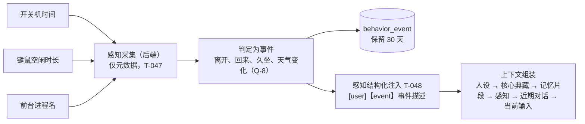
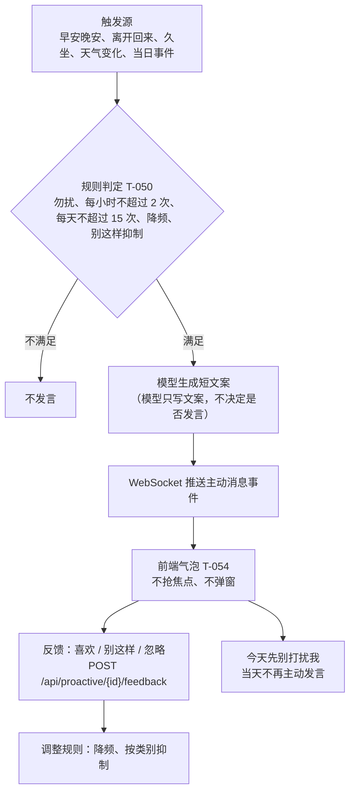
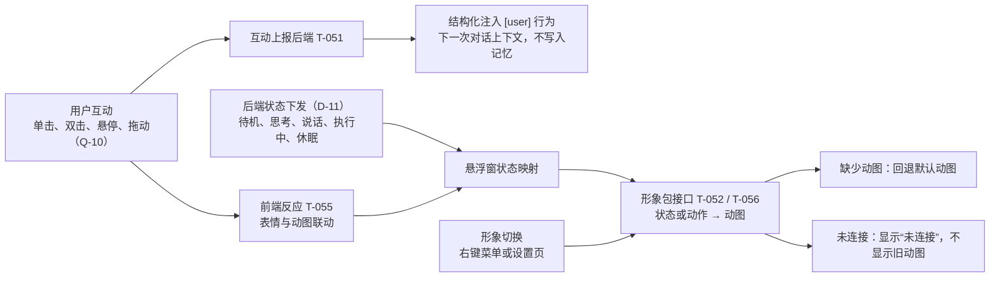

# 桌面宠物 · M3 陪伴与感知

## 一、业务背景与目标

### 业务问题

M1、M2 已完成：宠物可以多轮对话，日常对话与结构化记忆可查看与修改，设置页可切换模型与人设。但宠物目前只会被动回答，不了解用户的桌面状态，不会主动说话，悬浮窗的形象也没有可切换、可互动的设计。

M3 让宠物“陪伴”起来：感知用户的桌面行为，按规则主动说话，并以可切换的形象与用户互动。

### 已确认需求

- **形象包**：形象独立设计，与悬浮窗解耦，可切换。每套形象包含多组动图，每组对应一个状态或一个动作（D-15、D-16）。
- **右键菜单**：首批包含“切换模型”；其余菜单项待 Q-9 确认。
- **基础互动**：前端反应与后端行为都要做（D-18）。互动上报后端，结构化注入提示词（D-17）。
- **主动消息**：以气泡出现，不抢焦点、不弹模态框；每条消息下有“喜欢 / 别这样 / 忽略”，并提供“今天先别打扰我”（PRD §3.3）。
- **感知**：开关机时间、键鼠空闲时长、前台进程名，仅元数据；感知以结构化行注入提示词（D-14、D-19；PRD §4.3）。
- **天气**：城市来源（手动或系统定位）、数据源与天气变化事件（PRD §4.5；细节待 Q-7）。
- **调度与勿扰**：主动发言由规则决定，模型只写文案；频率上限与降频（PRD §4.4）。
- **设置页**：感知开关、勿扰时段、天气城市与定位权限状态（PRD §3.4；范围待 Q-11）。

**不含范围**

- 能力扩展（M6）、聊天记录导入（M5）。
- 日终摘要、从对话自动推断记忆（PRD §5.4、§5.5）。
- 形象动画状态机与语音。M3 只接入形象包与动图。

### 目标

M3 完成后：

- 宠物能感知用户的桌面行为，并在对话中体现；
- 宠物按规则主动说话，用户可以反馈；
- 悬浮窗形象可切换，随状态与互动变化；
- 右键菜单可切换模型；
- 设置页可管理感知、勿扰与天气。

### 任务索引

| 编号 | 标题 | 依赖 | 状态 |
|---|---|---|---|
| T-047 | 感知采集（开关机、键鼠空闲、前台进程名，仅元数据） | — | 阻塞（待 Q-8 讨论结论） |
| T-048 | 感知事件结构化注入（`[user]【event】…`） | T-036、T-047 | 待办 |
| T-049 | 天气服务 | — | 阻塞（待 Q-7 讨论结论） |
| T-050 | 调度与主动消息（规则、频率上限、反馈、今天先别打扰我） | T-047、T-049 | 待办 |
| T-051 | 互动接入后端（上报，结构化注入 `[user] 行为`） | T-036 | 阻塞（待 Q-10 讨论结论） |
| T-052 | 形象解耦与可切换形象（形象包、多套动图） | T-040 | 待办 |
| T-053 | 右键菜单（切换模型；其余菜单项待 Q-9） | T-040、T-042 | 待办 |
| T-054 | 主动消息气泡与反馈（喜欢 / 别这样 / 忽略） | T-050 | 待办 |
| T-055 | 基础互动（前端反应与上报） | T-051、T-052 | 待办 |
| T-056 | 状态联动形象动图 | T-052 | 待办 |
| T-057 | 设置页：感知、勿扰、天气 | T-047、T-049 | 阻塞（待 Q-11 讨论结论） |
| T-058 | M3 收尾：目视核验、真实窗口交互测试、文档同步 | T-047 至 T-057 | 待办 |

依赖的已完成任务（M1–M2）：T-036（对话接入记忆）、T-040（悬浮窗）、T-042（设置页模型）。

## 二、当前业务工作流（mermaid）

### 2.1 感知与注入（T-047、T-048）

### 2.2 主动消息与反馈（T-050、T-054）

### 2.3 互动与形象（T-051、T-052、T-055、T-056）

### 2.4 右键菜单（T-053）

## 三、审查结论

- 阶段：M3 规划已完成，尚未开始实现。
- 正在做：无。等待 Q-7、Q-8、Q-9、Q-10、Q-11 的讨论结论。
- 下一步：先讨论 Q-8（感知采集设计，需多轮讨论）；确认 Q-9（右键菜单项）；确定 Q-7 的凭据格式、缓存时长与是否保留高德备选。
- 阻塞项：T-047、T-049、T-051、T-057 分别等待 Q-8、Q-7、Q-10、Q-11。
- 承接自 M2 的已知限制：
  - 主 agent 决定是否检索记忆（Q-4）的规划调用未实现，对话只注入核心典藏；
  - 未用真实模型做端到端验证（E2E 使用本地假模型），界面目视与交互未验证；
  - 前后端类别标签用词不同（前端：事件、互动；提示词：事项、互动约定）。
- 文档状态：PRD（v0.7）已在里程碑表后标注 M3 为目标范围。Arch 与 README 在 M3 实现时同步更新（感知、形象包、右键菜单）。

## 四、非目标/约束

- 文档职责：需求与选型见 `桌面宠物PRD.md`，架构见 `Arch.md`，本文件只记录 M3 的计划、状态与决策。
- 完成定义（DoD）：代码与测试通过；ruff / ESLint / Prettier 通过；相关文档已更新；已提交并记录提交号。
- 任务状态只取以下四种：待办、进行中、已完成、阻塞（阻塞须注明原因）。
- 感知只采集元数据：不记录键盘内容，不截屏，元数据保留 30 天（PRD §4.3）。
- 经纬度只在本地用于查询天气，不做额外存储（PRD §4.5）。
- 主动消息的发言时机由规则决定，模型只写文案（PRD §4.4）。
- 涉及待定事项（Q-7 至 Q-11）的任务，在结论确定前不编写实现代码。

## 五、待确认问题与风险

| 编号 | 事项 | 状态（待定/已定） | 结论 |
|---|---|---|---|
| Q-7 | 天气服务实现方式 | 待定 | 基于 PRD §4.5：首选和风天气（QWeather），统一接口封装，换源不影响上层；定位首选 Windows 定位服务（pywinrt），权限被拒或失败时回退手动城市。待确认：和风凭据格式（`QWEATHER_API_HOST`、`QWEATHER_CREDENTIAL`）、缓存时长、是否实现高德备选。影响 T-049 |
| Q-8 | 感知采集设计 | 待定 | 需多轮讨论：采集频率；离开、回来、久坐的判定阈值；事件与 `behavior_event` 的关系；30 天保留；前台进程名的采集与存储边界。影响 T-047、T-048 |
| Q-9 | 右键菜单项 | 待定 | 已确认包含“切换模型”。其余候选：打开对话、打开设置、今天先别打扰我、暂停或恢复主动消息、退出。影响 T-053 |
| Q-10 | 互动行为清单 | 待定 | 需讨论：前端可识别的互动（单击、双击、悬停、拖动等），各自的前端反应，以及上报后端时的结构化文本（`[user] <行为>`）。影响 T-051、T-055 |
| Q-11 | 天气与勿扰设置的范围与设计 | 待定 | 需讨论：设置页的呈现方式；勿扰默认时段（23:00–08:00）与“今天先别打扰我”的关系；定位权限状态的展示。影响 T-057 |

## 六、已确认口径

| 编号 | 口径 | 状态（待定/已定） | 结论 |
|---|---|---|---|
| D-11 | 悬浮窗状态由谁决定 | 已定 | 由后端决定，通过 WebSocket 下发（PRD §3.1） |
| D-14 | 感知进入提示词的格式 | 已定（2026-10-27） | 感知以结构化行注入上下文：`[user]【event】<事件描述>`，由后端生成。感知事件进入上下文，不写入结构化记忆 |
| D-15 | 形象与悬浮窗的关系 | 已定（2026-10-27） | 形象独立设计为“形象包”，与悬浮窗解耦；悬浮窗通过统一接口接入形象包，支持切换。占位形象作为默认形象包 |
| D-16 | 形象动图与状态的对应 | 已定（2026-10-27） | 每套形象包含多组动图，每组动图对应一个状态或一个动作（待机、思考、说话、执行中、休眠，以及互动动作） |
| D-17 | 互动的数据流 | 已定（2026-10-27） | 互动由前端上报后端，后端把互动结构化为 `[user] <行为>` 注入提示词。状态仍由后端下发（D-11） |
| D-18 | 桌宠互动的范围 | 已定（2026-10-27） | 同时包含前端反应与后端行为。具体行为清单见 Q-10 |
| D-19 | 前台应用感知 | 已定（2026-10-27） | 纳入 M3，采用简单设计（只取前台进程名，PRD §4.3）。采集细节见 Q-8 |

## 七、实施任务与依赖

> 维护：口径或实施条件变化时更新、重规划。编号按执行顺序排列。“任务状态”与“验收/验证结果”在任务完成时补充。

### T-047 感知采集（仅元数据）

**目的**：采集开关机时间、键鼠空闲时长与前台进程名，作为感知事件与主动消息的来源（PRD §4.3）。

**依赖**：—

**范围**：
- `infra/system/`：键鼠空闲（`idle.py`，`GetLastInputInfo`）、前台进程（`foreground.py`，`ctypes` + `psutil`）、开关机时间；
- `service/perception/`：把原始元数据判定为事件（离开、回来、久坐）；
- 元数据写入 `behavior_event`，保留 30 天；
- 验收要点：只写元数据，不记录键盘内容，不截屏；采集失败不影响对话与其他功能；超过 30 天的元数据被清理。采集频率与判定阈值待 Q-8。

### T-048 感知事件结构化注入

**目的**：感知事件以结构化形式进入提示词，让宠物知道用户刚刚的状态（D-14）。

**依赖**：T-036、T-047

**范围**：
- `service/chat/context.py` 增加感知段，格式 `[user]【event】<事件描述>`，位于近期对话之前；
- 感知事件不写入结构化记忆，不进入 `daily_log`；
- 同样受预算约束，超出时裁剪最早的事件；
- 验收要点：人设与核心典藏不被裁剪；注入位置与格式正确。

### T-049 天气服务

**目的**：提供天气查询与天气变化事件（PRD §4.5）。

**依赖**：—

**范围**：
- `service/weather/`：缓存策略、失败降级文案、定位失败回退手动城市；
- `infra/weather/`：数据源客户端，统一接口，换源不影响上层；
- 天气变化作为感知事件进入提示词，格式同 D-14；
- 数据源、凭据与缓存时长待 Q-7；
- 验收要点：天气可查询，缓存生效，失败时给出降级文案；定位失败时回退手动城市；经纬度只在本地使用。

### T-050 调度与主动消息

**目的**：由规则决定何时主动说话，模型只负责写文案（PRD §3.3、§4.4）。

**依赖**：T-047、T-049

**范围**：
- `service/proactive/rules.py`：触发源、勿扰、频率上限（每小时 2 次，每天 15 次）、同类提醒忽略 3 次后降频、“别这样”的类别抑制；
- `service/proactive/scheduler.py`：tick 循环与补跑；
- `service/proactive/proactive_service.py`：生成文案并推送；
- 接口：`POST /api/proactive/{id}/feedback`（喜欢、别这样、忽略）；“今天先别打扰我”写入勿扰状态；
- 验收要点：各触发源按规则产生消息；频率上限与降频生效；反馈写入后端；当天选择“今天先别打扰我”后不再主动发言。

### T-051 互动接入后端

**目的**：前端的互动上报后端，并结构化进入提示词（D-17）。

**依赖**：T-036

**范围**：
- 新增互动上报接口；
- 后端把互动结构化为 `[user] <行为>`，注入下一次对话的上下文，与感知段相邻；
- 互动不写入结构化记忆；
- 具体行为清单与后端行为待 Q-10。

### T-052 形象解耦与可切换形象

**目的**：形象作为独立设计，悬浮窗通过统一接口接入，可切换（D-15）。

**依赖**：T-040

**范围**：
- 形象包的目录结构与清单格式（形象名，以及各状态与动作对应的动图）；
- 悬浮窗只依赖形象包接口，不包含形象的具体实现；
- 占位形象改写为默认形象包；
- 形象切换入口：右键菜单（T-053）与设置页；
- 验收要点：至少两套形象包可切换，切换后立即生效并记住选择；缺少动图时回退默认动图，不出现空白。

### T-053 右键菜单

**目的**：提供右键菜单，首批包含“切换模型”（Q-9 确认其余菜单项）。

**依赖**：T-040、T-042

**范围**：
- 悬浮窗右键菜单；
- “切换模型”复用设置页的模型切换能力，下一次对话生效；
- 其余菜单项在 Q-9 确认后加入；如需“退出”，新增 Rust 命令并在 capability 中授权；
- 验收要点：菜单可打开；不影响拖动与单击打开对话。

### T-054 主动消息气泡与反馈

**目的**：呈现主动消息，并收集反馈（PRD §3.3）。

**依赖**：T-050

**范围**：
- 气泡不抢焦点、不弹模态框；
- 每条消息下有“喜欢”“别这样”“忽略”三个按钮，结果写入后端；
- 提供“今天先别打扰我”按钮；
- 验收要点：三个按钮的结果写入后端；“今天先别打扰我”生效后当天不再出现主动消息。

### T-055 基础互动

**目的**：桌宠对用户的互动有前端反应，并上报后端（D-18）。

**依赖**：T-051、T-052

**范围**：
- 前端识别互动并给出反应（清单见 Q-10）；
- 每次互动上报后端（D-17）；
- 互动反应与形象动图联动（T-056）；
- 验收要点：每种已确认的互动都有前端反应并上报后端；互动不阻塞拖动与对话。

### T-056 状态联动形象动图

**目的**：五种状态与互动动作对应到形象包的动图（D-16）。

**依赖**：T-052

**范围**：
- 状态（待机、思考、说话、执行中、休眠）与动作由形象包中的动图表示；
- 状态由后端下发（D-11）；
- 验收要点：五种状态各有对应动图，切换状态时动图随之切换；断开连接时显示“未连接”，不显示旧动图。

### T-057 设置页：感知、勿扰、天气

**目的**：PRD §3.4 中的感知、勿扰与天气设置（范围见 Q-11）。

**依赖**：T-047、T-049

**范围**：
- 感知各项开关；
- 勿扰时段（默认 23:00–08:00）；
- 天气城市（手动或定位）与定位权限状态；
- 验收要点：设置变更后，感知与主动消息立即按新设置执行；不显示任何密钥。

### T-058 M3 收尾

**目的**：M3 以界面为主，完成目视核验与真实窗口交互测试，并同步文档。

**依赖**：T-047 至 T-057

**范围**：
- 目视核验：悬浮窗、气泡、右键菜单、设置页、对话窗口；
- 真实 Tauri 窗口的交互测试；
- 端到端验证扩展：感知、主动消息、互动、形象切换；
- 同步 PRD（右键菜单、互动、形象包的正式描述）、Arch 与 README；
- 打阶段标签；
- 验收要点：目视核验记录完成，问题已修复或记录；真实窗口交互测试通过；端到端验证通过，文档与实现一致。
