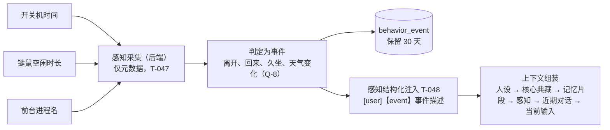
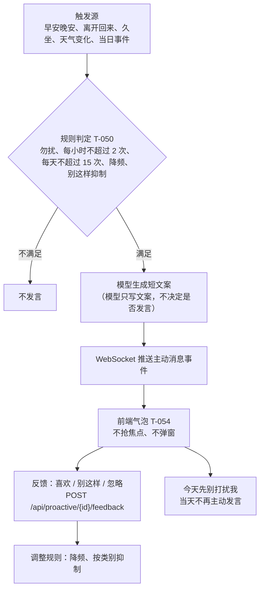
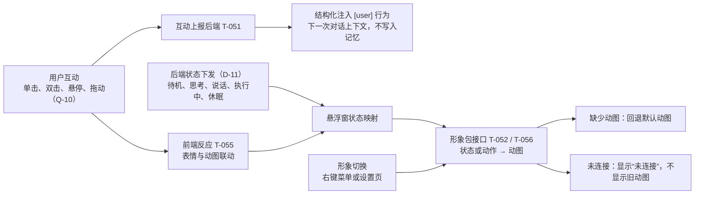

# 桌面宠物 · 任务计划（M1–M2 已完成，当前 M3）

## 一、业务背景与目标

### 业务问题

宠物需要能与用户多轮对话（流式输出），角色设定稳定；日常对话可以完整保留、结构化记忆可以查看与修改；设置页可以切换模型。前期骨架（M0）、对话与记忆管理（M1、M2）已完成。当前阶段（M3）让宠物“陪伴”起来：感知用户的桌面行为、按规则主动说话，并以可切换的形象与用户互动。

前期任务（T-001 至 T-017）的完整记录见 `Task-archive.md`。

### 已确认需求

**纳入范围（M1–M2，已完成）**
- 悬浮窗（占位形象与状态标签）、对话窗口、设置页（模型、记忆）
- 角色卡与提示词注入（`prompt.py`）
- 模型切换（对话模型、整理模型）与用量记录
- 记忆：`daily_log` 完整保留、结构化记忆（关键词触发写入、编辑）、记忆索引、按行号区间检索、上下文组装、查看与编辑、临时模式、核心典藏
- sub agent 编排（ReAct）、agent 文件工具（草稿本读写）

**纳入范围（M3，当前阶段）**
- 形象包：形象与悬浮窗解耦，可切换；每套形象含多组动图，每组对应一个状态或动作（D-15、D-16）
- 右键菜单：首批包含“切换模型”，其余菜单项待 Q-9 确认
- 基础互动：前端反应与后端行为（D-18），互动结构化注入提示词（D-17）
- 主动消息气泡与反馈（喜欢 / 别这样 / 忽略），“今天先别打扰我”（PRD §3.3）
- 感知：开关机时间、键鼠空闲时长、前台进程名，仅元数据；感知结构化注入提示词（D-14、D-19）
- 天气（PRD §4.5）、调度与勿扰（PRD §4.4）
- 设置页：感知、勿扰、天气（PRD §3.4，范围待 Q-11）

**不含范围**（见 PRD §8 对应条目）
- 能力扩展、聊天记录导入
- 日终摘要、从对话自动推断记忆（PRD §5.5、§5.4）
- 形象动画状态机与语音（M3 只接入形象包与动图）

### 目标

宠物可以与用户多轮对话（流式输出），角色设定稳定；对话与记忆可以查看、修改；设置页可以切换模型（M1–M2，已完成）。M3 目标：宠物能感知用户的桌面行为，按规则主动说话，并以可切换的形象与用户互动。

### 任务索引

| 编号 | 标题 | 依赖 | 状态 |
|---|---|---|---|
| T-018 | 角色卡加载与校验 | — | 已完成 |
| T-019 | 角色卡版本记录（`persona_version`） | T-018 | 已完成 |
| T-020 | 迁移 0003：llm_usage 扩展、agent_run、旧表清理 | — | 已完成 |
| T-021 | LLM 用量记录（client 包装） | T-020 | 已完成 |
| T-022 | 当前模型接口：`GET/PUT /api/llm/active` | T-021 | 已完成 |
| T-023 | daily_log 存储与临时模式写入控制 | — | 已完成 |
| T-024 | 提示词构建（`prompt.py`，模板与注入） | T-018、T-019 | 已完成 |
| T-025 | 对话用例：模型调用（非流式）与句长校验 | T-021、T-023、T-024 | 已完成 |
| T-026 | 事件总线与 WebSocket 推送 | T-025 | 已完成 |
| T-027 | 对话接口：`POST /api/chat`、`GET /api/chat/history` | T-025、T-026 | 已完成 |
| T-028 | 文件 IO 与权限（`infra/files`） | — | 已完成 |
| T-029 | agent 文件工具（`service/agent/tools/file.py`） | T-028 | 已完成 |
| T-030 | 结构化记忆存储（JSON 文件） | T-023 | 已完成 |
| T-031 | 记忆索引生成（由代码生成） | T-030 | 已完成 |
| T-032 | 记忆读取工具与行号 helper | T-030、T-031 | 已完成 |
| T-033 | sub agent 编排（ReAct、能力描述、检查点） | T-021、T-029、T-032 | 已完成 |
| T-034 | 结构化记忆写入与编辑（关键词触发） | T-033 | 已完成 |
| T-035 | 核心典藏（最多 20 条） | T-030 | 已完成 |
| T-036 | 对话接入记忆（上下文组装、每日 reset） | T-025、T-033、T-035 | 已完成 |
| T-037 | 记忆管理接口：`/api/memories` 与临时模式 | T-023、T-030、T-035 | 已完成 |
| T-038 | 前端接口层与契约重新生成 | T-022、T-027、T-037 | 已完成 |
| T-039 | 桌面壳迁移到 Tauri 2（Rust 核心、拉起后端、命令与窗口） | — | 已完成 |
| T-040 | 悬浮窗（占位形象与状态标签） | T-026、T-039 | 已完成 |
| T-041 | 对话窗口（多轮、流式、历史与搜索） | T-038、T-039 | 已完成 |
| T-042 | 设置页：模型（列表、可用性、切换、重载） | T-022、T-038、T-039 | 已完成 |
| T-043 | 设置页：记忆（查看、编辑、删除、临时模式、核心典藏） | T-035、T-037、T-038、T-039 | 已完成 |
| T-044 | 回复中的记忆来源 | T-036、T-041 | 已完成 |
| T-045 | 阶段收尾：端到端验证与文档同步 | T-039 至 T-044 | 已完成 |
| T-046 | 人设卡片：多卡选择与切换（D-13） | T-018、T-019、T-024 | 已完成 |
| T-047 | 感知采集（开关机、键鼠空闲、前台应用，仅元数据） | — | 阻塞（待 Q-8 讨论结论） |
| T-048 | 感知事件结构化注入（`[user]【event】…`） | T-036、T-047 | 待办 |
| T-049 | 天气服务 | — | 阻塞（待 Q-7 讨论结论） |
| T-050 | 调度与主动消息（规则、频率上限、反馈、今天先别打扰我） | T-047、T-049 | 待办 |
| T-051 | 互动接入后端（上报，结构化注入 `[user] 行为`） | T-036 | 阻塞（待 Q-10 讨论结论） |
| T-052 | 形象解耦与可切换形象（形象包、多套动图） | T-040 | 待办 |
| T-053 | 右键菜单（切换模型；其余菜单项待 Q-9） | T-040、T-042 | 待办 |
| T-054 | 主动消息气泡与反馈（喜欢 / 别这样 / 忽略） | T-050 | 待办 |
| T-055 | 基础互动（前端反应与上报） | T-051、T-052 | 待办 |
| T-056 | 状态联动形象动图 | T-052 | 待办 |
| T-057 | 设置页：感知、勿扰、天气 | T-047、T-049 | 阻塞（待 Q-11 讨论结论） |
| T-058 | M3 收尾：目视核验、真实窗口交互测试、文档同步 | T-047 至 T-057 | 待办 |

## 二、当前业务工作流（mermaid）

以下为 M3 的业务流程，依据第六节的 D-14 至 D-19 与 PRD §3、§4。节点中带 Q 编号的，表示对应细节仍待讨论，结论确定前不实现。

### 2.1 感知与注入（T-047、T-048）

### 2.2 主动消息与反馈（T-050、T-054）

### 2.3 互动与形象（T-051、T-052、T-055、T-056）

### 2.4 右键菜单（T-053）

## 三、审查结论

- 阶段：基础对话与记忆管理（M1、M2）已完成，阶段标签 `m2-memory`；当前为 M3（陪伴与感知）规划阶段，尚未开始实现
- 正在做：M3 规划（T-047 至 T-058）。已确认的决定见 D-14 至 D-19；待讨论的事项见 Q-7 至 Q-11。
- 下一步：讨论 Q-8（感知采集设计）与 Q-7（天气服务实现）；确认 Q-9（右键菜单项）。讨论结论落地后再拆分各任务的实现。
- 阻塞项：T-047、T-049、T-051、T-057 等待 Q-7、Q-8、Q-10、Q-11 的讨论结论。
- 已知限制（进入下一阶段前需要处理或确认）：
  - 主 agent 决定是否检索记忆（Q-4）的规划调用未实现，对话只注入核心典藏。
  - 未用真实模型做端到端验证（E2E 使用本地假模型），界面目视与交互未验证。
  - 前后端类别标签用词不同（前端：事件、互动；上下文提示：事项、互动约定）。
- 文档状态：PRD 已按 v0.7 修订，并在里程碑表后标注实现状态；Arch 已更新为 v0.5（目录树、数据流、接口表与实现一致）；README 进度与运行方式已同步。

## 四、非目标/约束

- 文档职责：需求与选型见 `桌面宠物PRD.md`，架构见 `Arch.md`，本文件只记录计划、状态与决策。
- 完成定义（DoD）：代码与测试通过；ruff / ESLint / Prettier 通过；相关文档已更新；已提交并记录提交号。
- 任务状态只取以下四种：待办、进行中、已完成、阻塞（阻塞须注明原因）。
- 不含范围见第一节“已确认需求”。
- M3 约束：感知只采集元数据，不记录键盘内容，不截屏（PRD §4.3）；经纬度只在本地用于查询天气，不做额外存储（PRD §4.5）。
- 涉及待定事项（Q-7 至 Q-11）的任务，在结论确定前不编写实现代码。

## 五、待确认问题与风险

| 编号 | 事项 | 状态（待定/已定） | 结论 |
|---|---|---|---|
| Q-7 | 天气服务实现方式 | 待定 | 基于 PRD §4.5：首选和风天气（QWeather），统一接口封装，换源不影响上层；定位首选 Windows 定位服务（pywinrt），权限被拒或失败时回退手动城市。待确认：和风凭据格式（`QWEATHER_API_HOST`、`QWEATHER_CREDENTIAL`）、缓存时长、是否实现高德备选。影响 T-049 |
| Q-8 | 感知采集设计 | 待定 | 需多轮讨论：采集频率；离开、回来、久坐的判定阈值；事件与 `behavior_event` 的关系；30 天保留；前台进程名的采集与存储边界。影响 T-047、T-048 |
| Q-9 | 右键菜单项 | 待定 | 已确认包含“切换模型”。其余候选：打开对话、打开设置、今天先别打扰我、暂停或恢复主动消息、退出。影响 T-053 |
| Q-10 | 互动行为清单 | 待定 | 需讨论：前端可识别的互动（单击、双击、悬停、拖动等），各自的前端反应，以及上报后端时的结构化文本（`[user] <行为>`）。影响 T-051、T-055 |
| Q-11 | 天气与勿扰设置的范围与设计 | 待定 | 需讨论：设置页的呈现方式；勿扰默认时段（23:00–08:00）与“今天先别打扰我”的关系；定位权限状态的展示。影响 T-057 |

## 六、已确认口径

| 编号 | 口径 | 状态（待定/已定） | 结论 |
|---|---|---|---|
| D-8 | 上下文预算如何计量 | 已定 | 先按字符数估算（中文约 1 字 ≈ 1 token），不引入分词器（2026-10-25）。影响 T-036 |
| Q-3 | `daily_log` 原文保留与旧表去留 | 已定 | `daily_log` 原文永久保留；删除 `memory`、`memory_archive`、`daily_summary`、`consolidation_run`，由 T-020 迁移处理（2026-10-25） |
| Q-4 | 每轮是否都派发记忆读取 | 已定 | 由主 agent 根据能力描述决定，不强制每轮读取（2026-10-25）。影响 T-033、T-036 |
| Q-5 | 从对话中推断记忆是否纳入 | 已定 | 本阶段不纳入，只做关键词触发与用户明确要求的写入（PRD M4）（2026-10-25） |
| Q-6 | 草稿本写入是否需要用户确认 | 已定 | 草稿本写入不需要用户确认。该规则属于文件权限设计，由 `infra/files/access.py`（T-028）承担，不在 agent 工具层做确认（2026-10-25）。影响 T-029 |
| D-5 | 记忆管理是否纳入本阶段 | 已定 | 纳入（2026-10-24） |
| D-6 | 结构化记忆如何写入 | 已定 | 关键词触发或用户明确要求，由 sub agent 写入；纳入本阶段（修订原“仅手动”） |
| D-7 | 流式传输协议 | 已定 | WebSocket（2026-10-24） |
| D-9 | 人设如何修改 | 已定（2026-10-27 修订） | 人设内容只允许手动修改 `backend/config/personas/<id>.yaml`；设置页只切换“启用哪一张卡”，不编辑内容；对话中的“扮演”仅对本次有效（PRD §6.3） |
| D-10 | 临时模式状态存放在哪里 | 已定 | 存入 `app_setting`，键为 `memory.temporary_mode`；开启时不写 `daily_log`，不写结构化记忆 |
| D-11 | 悬浮窗状态由谁决定 | 已定 | 由后端决定，通过 WebSocket 下发（PRD §3.1） |
| D-12 | 桌面壳技术选型 | 已定 | 改用 Tauri 2（Rust 核心），替代 Electron（2026-10-26）。M0 的 `frontend/electron/` 代码由 T-039 迁移 |
| D-13 | 人设卡片 | 已定（2026-10-27） | 多张人设卡，每卡一个文件 `backend/config/personas/<id>.yaml`，id 为文件名（允许中文、字母、数字、下划线、连字符）。默认 id 为 `芙芙`，由 `constants/agent.py` 的 `DEFAULT_PERSONA_ID` 定义。启用状态存 `app_setting`（键 `persona.active`），未设置时用默认 id。切换后下一次对话生效：写入一条会话边界记录（`daily_log` 的 `event` 行，供历史显示“新会话”），近期对话保留在上下文中。记忆不按人设隔离。卡片每次请求检查修改时间，变化则重新解析；解析失败的卡标为不可用，不能启用 |
| D-14 | 感知进入提示词的格式 | 已定（2026-10-27） | 感知以结构化行注入上下文：`[user]【event】<事件描述>`，由后端生成。感知事件进入上下文，不写入结构化记忆 |
| D-15 | 形象与悬浮窗的关系 | 已定（2026-10-27） | 形象独立设计为“形象包”，与悬浮窗解耦；悬浮窗通过统一接口接入形象包，支持切换。占位形象作为默认形象包 |
| D-16 | 形象动图与状态的对应 | 已定（2026-10-27） | 每套形象包含多组动图，每组动图对应一个状态或一个动作（待机、思考、说话、执行中、休眠，以及互动动作） |
| D-17 | 互动的数据流 | 已定（2026-10-27） | 互动由前端上报后端，后端把互动结构化为 `[user] <行为>` 注入提示词。状态仍由后端下发（D-11） |
| D-18 | 桌宠互动的范围 | 已定（2026-10-27） | 同时包含前端反应与后端行为。具体行为清单见 Q-10 |
| D-19 | 前台应用感知 | 已定（2026-10-27） | 纳入 M3，采用简单设计（只取前台进程名，PRD §4.3）。采集细节见 Q-8 |
| 口径-1 | 任务编号规则 | 已定 | 本阶段任务编号从 T-018 开始，不使用里程碑序号 |
| A-1 | artifact 定义 | 已定 | Agent 产出、可再次引用、允许 CRUD；persona 不属于 artifact |
| A-2 | 结构化记忆与索引的真相 | 已定 | 真相为结构化记忆 JSON 文件与 SQLite `daily_log`；记忆索引 JSON 由代码根据存储生成，不手工编辑 |
| A-3 | 角色卡结构 | 已定（2026-10-25 修订） | 角色卡为通用 YAML 映射，不对字段名做约束；值为字符串、字符串列表或映射；列表规范化时去重排序 |
| A-4 | 提示词管理 | 已定 | `prompt.py` 负责构建、拼接、注入；模板为 `.md`，用 `string.Template` 占位，不引入新依赖；模板只保留当前版本，历史由 Git 保留，每次调用记录模板哈希 |
| A-5 | 人设注入路径 | 已定（2026-10-27 修订） | 当前启用的人设卡（`personas/<id>.yaml`）→ 模板占位 → 系统提示词固定首段；不走记忆检索，不被裁剪；每张卡的历史版本分别保存在 `persona_version`（按 `persona_id` 区分） |
| A-6 | 对话检查点与日整理 | 已定 | 检查点每日 reset（每天新 session）；日整理指主对话完整保留到 `daily_log`，不做摘要 |
| A-7 | 记忆分类 | 已定 | `daily_memory`（只读，存储表为 `daily_log`）与结构化记忆（可写、可编辑，由 sub agent 维护） |
| A-8 | 结构化记忆写入触发 | 已定 | 关键词触发（类似 skills）或用户明确要求；纳入本阶段 |
| A-9 | 有效期 | 已定 | 不设 `valid_from` / `valid_to`，不做有效期规则（删除 PRD 原 §5.3）；通过编辑维护 |
| A-10 | 记忆索引结构 | 已定 | 顶层为 `描述`（主 agent 只读）与 `记忆索引`（sub agent 读）；`daily_memory` 为 `{月份: [日期]}`，日期即 id |
| A-11 | 检索与行号 | 已定 | 取完整记录后按行号区间（`from-to`）截取，不全量注入；行号 helper 位于 `service/memory/memory_service.py`，仅供 sub agent 使用 |
| A-12 | sub agent 与编排 | 已定 | sub agent 为 ReAct 范式；记忆与提示词中不出现“sub agent”概念；主 agent 写执行计划并派发，检查点只保留 `执行：<能力>` 与输出结果，中间步骤写入 `agent_run` |
| A-13 | sub agent 模型 | 已定 | 使用 `consolidate` 角色的模型 |
| A-14 | LLM 用量记录 | 已定 | 每个 LLM client 记录结构化 token 用量与开始、结束时间，写入 `llm_usage`；token 不可得记 NULL，不估算 |
| A-15 | agent 执行记录 | 已定 | 新表 `agent_run` 记录 sub agent 行为路径与输出；不写日志，不写记忆；永久保留 |
| A-16 | 资源库 | 已定 | 路径以 `constants/path.py` 常数定义；内容不落库；取消 `config/resources.yaml` |
| A-17 | 文件读写 | 已定 | IO：`infra/files/io.py`；权限：`infra/files/access.py`；agent 接口：`service/agent/tools/file.py`；不作为某个能力 |
| A-18 | capabilities 职责 | 已定 | `backend/capabilities/` 放复杂原子能力（如天气）与受限动作（打开应用、打开网址） |
| A-19 | 目录归属 | 已定 | `service/agent/`（编排、prompt、能力描述、关键词触发、工具）；`service/memory/`（记忆读写、行号 helper、索引生成）；`service/llm/`（LLM 调用，不移入 agent） |
| A-20 | 发言长度 | 已定 | 单句不超过 40 字符，按字符数计（含标点）；人设中提示约 20 字 |
| A-21 | 错误回传 | 已定 | tool、sub agent、能力失败时，返回错误原因给调用方（agent），由 agent 及时调整工作。这是记忆系统的通用设计，不为单一场景设置专门的错误记录位置。句长超限时先重新生成一次，仍超限则以错误原因返回 |
| A-22 | 文档同步 | 已定 | PRD 已升至 v0.7，Arch 已按本口径修订；本节任务按本口径重排（2026-10-25） |

## 七、实施任务与依赖

> 编号按执行顺序排列。本节为按 2026-10-25 口径重排后的版本，旧版编号（T-018 至 T-035 的旧含义）作废，未开始的任务不影响已有编号的唯一性。

### T-018 角色卡加载与校验

**目的**：让角色卡以稳定、可校验的结构进入系统。

**依赖**：无

**任务状态**：已完成

**范围**：`backend/config/persona.py` 读取 `persona.yaml`，解析为通用 YAML 结构，不对字段名做要求。值只允许字符串、字符串列表与映射；列表去重并排序。错误一次性汇总。输出不可变的 `PersonaConfig` 与规范化 JSON。

**验收/验证结果**：
- [x] 值类型不支持或为空时启动失败，错误一次性汇总（方式：pytest `tests/config/test_persona.py::test_all_errors_are_reported_together`；`tests/test_main.py::test_invalid_persona_exits_with_error`；结果：通过）
- [x] 同一文件多次解析结果相同（方式：`test_same_file_parses_to_same_normalized_json`；结果：通过）
- [x] 列表顺序变化不影响规范化结果（方式：`test_key_order_does_not_change_normalized_json`；结果：通过）
- [x] 任意字段名可以解析（方式：`test_accepts_arbitrary_field_names`；结果：通过）
- 备注：`backend/config/persona.yaml` 由用户维护；`ruff check`、`ruff format --check` 通过；提交号 817187b

### T-019 角色卡版本记录

**目的**：角色卡变化可追溯、可回滚。

**依赖**：T-018

**任务状态**：已完成

**范围**：`infra/store/repositories/persona_version.py` 提供 `latest()` 与 `append()`（仓储只返回数据）。启动时，在数据库迁移之后，比较规范化 JSON 与最新版本：相同则不写入，不同则插入 version = 最大值 + 1。旧版本保留。

**验收/验证结果**：
- [x] 首次启动写入 version 1（方式：`tests/test_main.py::test_persona_version_is_recorded_on_startup`、`tests/service/test_persona_service.py::test_first_sync_writes_version_one`；结果：通过）
- [x] 内容不变时不新增版本（方式：`test_unchanged_content_adds_no_version`、启动测试第三次启动；结果：通过）
- [x] 内容变化后版本递增，旧版本仍在（方式：`test_changed_content_increments_and_keeps_old_version`、`tests/infra/test_persona_version.py`；结果：通过）
- [x] 校验失败时不写入版本（方式：`tests/test_main.py::test_invalid_persona_does_not_write_version`；结果：通过）
- 备注：`ruff check`、`ruff format --check` 通过；全量测试 189 项通过；提交号 5d3f3ed

### T-020 迁移 0003：llm_usage 扩展、agent_run、旧表清理

**目的**：为用量记录与 sub agent 执行记录提供表结构，并清理不再使用的旧表。

**依赖**：无（旧表处理依赖 Q-3）

**任务状态**：已完成。

**范围**：新增 `0003_agent.sql`：
- `llm_usage` 增加 `purpose`、`run_id`、`started_at`、`finished_at`、`usage_raw`、`prompt_hash`（SQLite 无法直接改列时新增列）。
- 新建 `agent_run`（字段见 PRD §7.7）。
- 删除 `memory_archive`、`daily_summary`、`consolidation_run`；`memory` 表由 JSON 文件承担，删除或保留按 Q-3 确定。
- `core_memory.memory_id` 改为引用结构化记忆 id（TEXT）。

**验收/验证结果**：
- [x] 空库与已有库上均可执行（方式：`tests/infra/test_store.py::test_migration_runs_on_empty_database`、`test_migration_upgrades_existing_database_and_keeps_usage_rows`；结果：通过）
- [x] `schema_version` 记录新版本，已应用文件不修改（方式：`test_second_migrate_is_a_no_op` 的版本列表、校验和检查；`git diff` 显示 0001、0002 未改动；结果：通过）
- [x] `tests/infra/test_store.py` 更新并通过（方式：pytest；结果：22 项通过）
- 备注：旧表中的数据为空，`core_memory` 的旧引用不迁移；`agent_run.status` 取值与旧 `consolidation_run` 一致；全量测试 194 项通过，ruff 检查和格式检查通过；提交号 fd3e5d6

### T-021 LLM 用量记录

**目的**：每次模型调用都有结构化记录，便于控制成本与排查。

**依赖**：T-020

**任务状态**：已完成

**范围**：`infra/llm/usage.py` 包装 LangChain client。每次 invoke 记录 provider、model、purpose、run_id（可空）、tokens_in / tokens_out（来自返回，不可得记 NULL）、usage_raw（JSON）、started_at、finished_at、latency_ms、success。时间为带时区 ISO 8601。

**验收/验证结果**：
- [x] 正常调用写入一条记录（方式：`tests/infra/test_llm_usage.py::test_db_sink_writes_success_and_failure_rows`、`test_successful_call_writes_one_record`；结果：通过）
- [x] 失败调用写入 success = 0（方式：`test_failed_call_writes_success_zero_and_reraises`、数据库测试；结果：通过）
- [x] token 不可得时为 NULL，不估算（方式：`test_missing_usage_is_recorded_as_null_not_estimated`；结果：通过）
- [x] 时间字段为带时区的 ISO 8601（方式：`test_timestamps_are_timezone_aware_iso8601`；结果：通过）
- 备注：通过 `usage_scope` 传入 purpose 与 run_id；`LlmService.client_for` 返回的包装对象同样记录用量（`test_client_for_records_usage_through_sink`）；目前只包装 `invoke` 与 `ainvoke`，流式调用的记录留给 T-026 / T-027；`prompt_hash` 留给 T-024 写入；全量测试 204 项通过；提交号 85a62c2

### T-022 当前模型接口

**目的**：用户可以在设置页切换当前对话模型与整理模型。

**依赖**：T-021

**任务状态**：已完成

**范围**：`GET /api/llm/active` 返回当前对话模型与整理模型；`PUT /api/llm/active` 修改，写入 `app_setting`，立即生效。优先级：数据库设置 > `.env` 的 `DEFAULT_*_MODEL`。

**验收/验证结果**：
- [x] 切换后，下一次调用使用新模型（方式：`tests/service/test_llm_service.py::test_switched_model_is_used_by_next_call`、`test_database_selection_persists_and_overrides_env`；结果：通过）
- [x] 指定的模型不满足角色要求（roles）时返回 422（方式：`tests/api/test_llm_routes.py::test_put_rejects_model_without_required_role`、`test_put_validates_all_selections_before_writing`；结果：通过）
- [x] 响应不包含密钥（方式：`tests/api/test_llm_routes.py::test_active_response_never_contains_secret_values`；结果：通过）
- 备注：优先级为 `active` 参数 > 数据库 `app_setting`（键 `llm.active.<能力>`，值 `provider/model`）> `.env` 默认值；每次调用时读取数据库，切换后立即生效；PUT 先校验全部提交的能力，全部通过才写入；响应中的 `source` 字段标明来源（`database` 或 `env`）；全量测试 215 项通过，ruff 检查和格式检查通过；提交号 0143be9

### T-023 daily_log 存储与临时模式写入控制

**目的**：保存日常对话原文，临时模式下不留痕。

**依赖**：无

**任务状态**：已完成

**范围**：`infra/store/repositories/daily_log.py` 提供写入、按日期读取完整记录、按日期与关键词查询（仓储只返回数据）。临时模式状态来自 `app_setting`（键 `memory.temporary_mode`），开关与写入控制在服务层判断。

**验收/验证结果**：
- [x] 每轮对话写入两条记录，时间为带时区的 ISO 8601（方式：`tests/service/test_daily_log_service.py::test_each_turn_writes_user_and_assistant_records`、`tests/infra/test_daily_log.py::test_timestamps_are_stored_with_timezone`；结果：通过）
- [x] 临时模式开启时不写入（方式：`test_temporary_mode_blocks_writes`、`test_temporary_mode_is_stored_in_app_setting`；结果：通过）
- [x] 按日期读取返回该日完整记录，按时间正序（方式：`tests/infra/test_daily_log.py::test_by_date_is_ascending_and_limited_to_the_day`；结果：通过）
- 备注：日期按 `PET_TIMEZONE` 计算；临时模式状态存于 `app_setting`（键 `memory.temporary_mode`）；每轮两条记录在同一事务中写入；搜索（关键词与日期范围）已提供，供 T-027 使用；全量测试 228 项通过，ruff 检查和格式检查通过；提交号 a6f5fa8

### T-024 提示词构建

**目的**：把角色卡、资源库与发言规则统一拼接为系统提示词。

**依赖**：T-018、T-019

**任务状态**：已完成。

**范围**：`service/agent/prompt.py` 负责构建、拼接、注入。模板位于 `service/agent/prompts/*.md`，使用 `string.Template` 占位。系统提示词段顺序：角色卡 → 资源库（按条拼接，每条一行，路径来自 `constants/path.py`）→ 发言规则（单句 40 字符、人设提示约 20 字，常量）→ 固定约束（如“不编造记忆”，写在模板中）。记录模板哈希。

**验收/验证结果**：
- [x] 同一输入渲染结果稳定（方式：`tests/service/test_prompt.py::test_same_input_renders_same_prompt`；结果：通过）
- [x] 资源库每条一行（方式：`test_resources_are_listed_one_per_line`；结果：通过）
- [x] 模板缺失或占位符不匹配时启动失败并给出明确错误（方式：`test_missing_template_fails_with_file_name`、`test_placeholder_mismatch_fails_with_expected_and_actual`；`main.py` 启动时调用 `load_templates()`，失败打印错误并退出；结果：通过）
- [x] 人设位于最前，不被裁剪（方式：`test_sections_follow_fixed_order`；结果：通过）
- 备注：段顺序为 人设 → 能力 → 资源库 → 发言规则 → 固定约束（能力段按 2026-10-26 确认的 persona + 能力 + 资产 放在人设之后）；资源路径相对项目根目录，常量定义于 `constants/path.py`（`RESOURCE_DIR`、`DRAFT_PATH`、`EMOJI_DIR`）；发言规则常量定义于 `constants/speech.py`；模板哈希由 `build_system_prompt` 返回（`template_digest`），由调用方通过 `usage_scope(prompt_hash=...)` 写入 `llm_usage.prompt_hash`；全量测试 236 项通过，ruff 检查和格式检查通过；提交号 1265c97

### T-025 对话用例：模型调用（非流式）与句长校验

**目的**：打通一次对话的模型调用，并保证单句长度可控。

**依赖**：T-021、T-023、T-024

**任务状态**：已完成。本任务不涉及预算（预算计量见 T-036，D-8 已定）。

**范围**：`service/chat/chat_service.py` 组合系统提示词与用户输入，调用对话模型（`chat` 角色），获取回复后做句长校验：按句号、问号、感叹号、省略号与换行分句，单句超过 40 字符（含标点）则重新生成一次；仍超限则以错误原因返回（A-21）。回复写入 `daily_log`（临时模式下不写）。模型失败返回明确错误，不编造回复。

**验收/验证结果**：
- [x] 正常调用返回回复文本，并写入 `llm_usage` 与 `daily_log`（方式：`tests/service/test_chat_service.py::test_normal_call_returns_reply_and_writes_usage_and_log`；结果：通过）
- [x] 未配置对话模型或密钥缺失时，返回明确错误并记录 success = 0（方式：`test_missing_key_is_clear_error_and_records_failure`、`test_unconfigured_chat_model_is_clear_error_and_records_failure`；结果：通过）
- [x] 单句超限时重新生成；仍超限时返回错误原因，不返回截断文本（方式：`test_overlong_sentence_is_regenerated_once`、`test_overlong_twice_returns_reason_not_truncated_text`；结果：通过）
- 备注：`ChatService.reply` 返回 `ChatReply(text, recorded)`，失败抛出 `ChatError(code, message)`，错误码为 `empty_input` / `model_unavailable` / `model_failed` / `sentence_too_long`；分句按 `。！？!?…` 与换行，句长含标点，上限取 `SENTENCE_MAX_CHARS`；模型调用失败由 `TrackedChatModel` 记录，未调用模型的不可用情况由服务层补记一条 `success = 0`；模型的历史对话与记忆上下文留给 T-036，本任务的消息只含系统提示词与当前输入；全量测试 248 项通过，ruff 检查和格式检查通过；提交号 79a35dc

### T-026 事件总线与 WebSocket 推送

**目的**：把状态与流式回复实时推送给前端。

**依赖**：T-025

**任务状态**：已完成

**范围**：`infra/events/bus.py` 提供进程内发布与订阅；`api/routers/ws.py` 提供 `/ws`，鉴权同 `TokenAuthMiddleware`。事件类型：`status`（待机、思考、说话、执行中、休眠）、`chat.chunk`（流式片段）、`chat.done`。事件结构在 `api/schemas/events.py` 中定义。

**验收/验证结果**：
- [x] 未携带令牌的连接被关闭（1008）（方式：`tests/api/test_ws.py::test_connection_without_token_is_closed_with_1008`、`test_connection_with_wrong_token_is_closed_with_1008`；结果：通过）
- [x] 订阅者收到的事件顺序与发布顺序一致（方式：`tests/infra/test_event_bus.py::test_subscribers_receive_events_in_publish_order`、`test_publish_from_other_thread_is_delivered_in_order`；`tests/api/test_ws.py::test_events_arrive_in_publish_order`；结果：通过）
- [x] 慢订阅者不阻塞发布方（队列满时丢弃并计数）（方式：`test_publish_never_blocks_and_full_queue_drops_and_counts`、`test_slow_subscriber_does_not_affect_fast_subscriber`；结果：通过）
- [x] 事件结构纳入契约生成（方式：`tests/api/test_ws.py::test_openapi_contains_event_schemas`；`npm run gen:api:check` 通过；结果：通过）
- 备注：事件结构定义于 `api/schemas/events.py`（`status` 的 state 为 idle / thinking / speaking / executing / sleeping，`chat.chunk` 与 `chat.done` 含 `message_id` 与 `text`），以 `ServerEvent` 合并进 OpenAPI 的 components；所有投递经 `loop.call_soon_threadsafe`，因此顺序与 `publish()` 调用顺序一致，发布方可在任意线程调用；订阅在 accept 之前完成，连接建立后发布的事件不会丢失；鉴权沿用 `TokenAuthMiddleware`；前端契约已重新生成（仅新增）；全量测试 259 项通过，ruff 检查和格式检查通过；提交号 ec47fd1

### T-027 对话接口

**目的**：对外提供对话与历史接口。

**依赖**：T-025、T-026

**任务状态**：已完成

**范围**：`POST /api/chat` 接收用户输入，回复经 WebSocket 流式推送，接口返回最终回复。`GET /api/chat/history` 按日期范围与关键词分页返回 `daily_log`，结果按时间倒序。请求与响应体在 `api/schemas/chat.py` 中定义。

**验收/验证结果**：
- [x] 发送消息后，WebSocket 依次收到 `chat.chunk` 与 `chat.done`（方式：`tests/api/test_chat_routes.py::test_websocket_receives_chunks_then_done_in_order`、`tests/service/test_chat_service.py::test_events_follow_thinking_speaking_chunks_done_idle`；结果：通过）
- [x] 历史接口支持日期范围与关键词，结果按时间倒序（方式：`tests/api/test_chat_routes.py::test_history_is_newest_first`、`test_history_filters_by_keyword_and_date_range`、`test_history_pages_with_has_more`；结果：通过）
- 备注：
  - `POST /api/chat`（`send_chat`）同步执行，返回 `message_id`、`text`、`recorded`；失败时返回错误码：`empty_input` 422、`model_unavailable` 503、`model_failed` 502、`sentence_too_long` 502。
  - `GET /api/chat/history`（`list_chat_history`）支持 `date_from`、`date_to`、`keyword`、`limit`（默认 50，1–100）、`offset`，返回 `items` 与 `has_more`，按时间倒序。
  - 流式的粒度为句子：句长校验要求看到整句，所以回复先通过校验，再按句推送 `chat.chunk`，最后推送 `chat.done`；未做逐 token 推送。
  - 推送顺序为 `status: thinking` → `status: speaking` → 多个 `chat.chunk` → `chat.done` → `status: idle`；失败时也会回到 `idle`。
  - 服务层通过 `ChatEvents` 协议发布事件，api 层的 `BusEventPublisher` 负责构造 schema 对象，服务层不依赖 api。
  - `daily_log` 的搜索新增了倒序、分页参数（默认仍为正序）。
  - 前端契约已重新生成（仅新增）；全量测试 278 项通过，ruff 检查和格式检查通过；提交号 fa93d97

### T-028 文件 IO 与权限

**目的**：提供 agent 可用的文件读写基础设施，并集中执行路径权限。

**依赖**：无

**任务状态**：已完成

**范围**：
- `infra/files/io.py`：读取、按行读取、写入、替换段落、清空。只负责读写，不判断权限。
- `infra/files/access.py`：允许根目录来自 `constants/path.py` 的 `RESOURCE_DIR`；路径规范化；拒绝 `..` 穿越与符号链接逃逸；读、写分别校验。允许范围内的写入（含草稿本）不需要用户确认。

**验收/验证结果**：
- [x] 允许根目录之外的读写被拒绝，并返回原因（方式：`tests/infra/test_files_access.py::test_absolute_path_outside_root_is_denied_with_reason`、`test_parent_traversal_is_denied_with_reason`、`test_read_and_write_are_checked_separately`；结果：通过）
- [x] 指向允许根目录之外的符号链接被拒绝（方式：`tests/infra/test_files_access.py::test_junction_escape_is_denied_for_write`，用目录联接验证目录逃逸；结果：通过）
- [ ] 文件符号链接的拒绝（`test_symlink_pointing_outside_is_denied`、`test_directory_symlink_escape_is_denied_for_write`）在本机跳过：Windows 创建符号链接需要开发者模式或管理员权限，当前环境不具备。这两项需要在具备权限的环境中补跑。
- [x] 允许范围内的读写正常（方式：`test_relative_path_inside_root_is_allowed_for_read_and_write`、`test_absolute_path_inside_root_is_allowed`、`tests/infra/test_files_io.py`；结果：通过）
- 备注：`io.py` 只做读写，不判断权限；`access.py` 的 `check_read` / `check_write` 分别校验，根目录来自 `constants/path.py` 的 `RESOURCE_DIR`；拒绝原因包括 `..` 穿越、路径不在允许目录内、符号链接或目录联接指向允许目录之外；段落替换按空行分段，按段落序号替换（序号从 1 开始）；全量测试 294 项通过，3 项因环境限制跳过，ruff 检查和格式检查通过；提交号 983f3a2

### T-029 agent 文件工具

**目的**：让 agent 可以读取、写入、编辑、清空草稿本。

**依赖**：T-028

**任务状态**：已完成。草稿本写入不需要用户确认（Q-6 已定，权限由 T-028 的 `access.py` 承担）。

**范围**：`service/agent/tools/file.py` 暴露读取、写入、编辑、清空四个工具，内部调用 T-028 的 IO 与权限。失败时返回错误原因（A-21）。草稿本文件名在使用处与 `RESOURCE_DIR` 拼接。

**验收/验证结果**：
- [x] 工具返回结构化结果（方式：`tests/service/test_agent_file_tools.py::test_write_then_read_returns_structured_results`；结果：通过）
- [x] 失败时返回可读的错误原因（方式：`test_missing_file_returns_readable_reason`、`test_out_of_range_edit_returns_reason`；结果：通过）
- [x] 不允许的路径不会触发写入（方式：`test_path_traversal_is_denied_and_does_not_write`、`test_absolute_path_outside_root_is_denied_and_does_not_write`、`test_denied_edit_and_clear_do_not_touch_existing_file`；结果：通过）
- 备注：四个工具为 `file_read`、`file_write`、`file_edit`、`file_clear`，用 LangChain `@tool` 装饰，供 T-033 的 sub agent 绑定；工具接收资源库内的相对路径，在使用处与 `RESOURCE_DIR` 拼接，之后经 T-028 的权限检查；结果为 `{ok, action, path, content, error}`；`file_edit` 按段落序号替换，与 T-028 一致；工厂函数 `make_file_tools(root)` 便于测试注入临时目录；全量测试 305 项通过，3 项因环境限制跳过（见 T-028），ruff 检查和格式检查通过；提交号 b2e9cfb

### T-030 结构化记忆存储

**目的**：结构化记忆以 JSON 文件为真相保存。

**依赖**：T-023

**任务状态**：已完成

**范围**：每条结构化记忆一个文件 `data/memory/structured/<id>.json`，字段见 PRD §5.4。文件读写放在 `infra/files/`，增删改查的业务判断放在 `service/memory/memory_service.py`。id 不复用。`daily_memory` 的行号视图由 `service/memory/` 渲染：每日完整对话按轮渲染为文本行。

**验收/验证结果**：
- [x] 增删改查正常（方式：`tests/service/test_memory_service.py` 中的 create、get、list、update、delete 用例；结果：通过）
- [x] 每条记忆对应一个文件（方式：`test_create_writes_one_file_per_memory`、`test_created_file_matches_the_documented_format`；结果：通过）
- [x] 损坏的文件被跳过并返回错误原因，不影响其他条目（方式：`test_corrupt_json_is_skipped_with_reason`、`test_schema_invalid_file_is_skipped_with_reason`、`test_file_name_must_match_memory_id`；结果：通过）
- 备注：文件存放于 `data/memory/structured/<id>.json`（`constants/path.py` 的 `STRUCTURED_MEMORY_DIR`）；文件读写在 `infra/files/json_store.py`（`JsonDirectory`，写入先写临时文件再替换），业务在 `service/memory/memory_service.py`；id 格式 `m_YYYYMMDD_NNN`，每天的序号持久化在 `app_setting`（键 `memory.structured.seq.<日期>`），删除后不复用；`source.type` 取 `keyword`（关键词触发）或 `explicit`（用户明确要求），此取值为本任务的选择，PRD 只给出示例；`importance` 默认 3，取值 1–5（沿用旧表约束）；`daily_memory` 行号视图 `render_daily_turns` 按轮渲染，每轮一行，换行折叠为空格；全量测试 324 项通过，3 项因符号链接权限跳过，ruff 检查和格式检查通过；提交号 2ff5026

### T-031 记忆索引生成

**目的**：生成主 agent 与 sub agent 使用的索引文件。

**依赖**：T-030

**任务状态**：已完成

**范围**：`service/memory/index.py` 根据 JSON 文件与 `daily_log` 生成 `data/memory/index.json`，顶层为 `描述` 与 `记忆索引`（格式见 PRD §5.3）。时机：结构化记忆增删改后，以及启动时。索引不手工编辑。

**验收/验证结果**：
- [x] 索引与存储一致（方式：`tests/service/test_memory_index.py::test_index_matches_storage_exactly`、`test_index_file_matches_storage_after_create`、`test_index_is_updated_after_update`；结果：通过）
- [x] 删除文件后索引随之更新（方式：`test_deleting_a_memory_removes_it_from_index`、`test_external_file_removal_is_reflected_on_rebuild`；结果：通过）
- [x] `daily_memory` 为 `{月份: [日期]}`（方式：`test_daily_memory_is_grouped_by_month_with_sorted_unique_dates`、`test_daily_memory_dates_come_from_daily_log`；结果：通过）
- 备注：索引文件为 `data/memory/index.json`（`constants/path.py` 的 `MEMORY_INDEX_FILE`），顶层 `描述` 与 `记忆索引` 按 PRD §5.3；结构化记忆取自 `StructuredMemoryService.list()`，损坏文件不进入索引；`StructuredMemoryService.add_listener` 在增删改后触发重建；启动时（数据库迁移之后）重建一次；内容未变化时不重写；写入沿用原子写入（`infra/files/json_store.py` 的 `write_json_atomic`，`JsonDirectory` 也改为调用它）；已知限制：PRD 规定索引在增删改和启动时重建，因此当天新增的对话日期要到下次启动才会出现在 `daily_memory` 中，是否需要在新一天的首轮对话后重建，待确认；全量测试 335 项通过，3 项因符号链接权限跳过，ruff 检查和格式检查通过；提交号 23727e6

### T-032 记忆读取工具与行号 helper

**目的**：sub agent 可以列出、查看、读取记忆，并按行号区间截取片段。

**依赖**：T-030、T-031

**任务状态**：已完成

**范围**：`service/memory/memory_service.py` 提供：读取描述、查看索引、读取条目、行号 helper（在每行开头补填行号，从 1 开始，仅供 sub agent 使用）、按 `from-to` 截取片段。通过 `service/agent/tools/` 暴露。

**验收/验证结果**：
- [x] `from-to` 超出范围时返回错误原因（方式：`tests/service/test_memory_reader.py::test_section_out_of_range_returns_reason`、`test_daily_range_out_of_bounds_is_reported`、`test_tool_range_error_is_returned_not_raised`；结果：通过）
- [x] 行号从 1 开始（方式：`test_line_numbers_start_at_one_and_do_not_change_content`、`test_reads_structured_memory_with_line_numbers`；结果：通过）
- [x] 行号 helper 只在返回文本前加前缀，不改变内容（方式：`test_line_numbers_start_at_one_and_do_not_change_content` 去掉前缀后与原文逐行一致；结果：通过）
- 备注：`MemoryReader` 提供 `describe()`（读取索引的 `描述`）、`index()`（`记忆索引`）、`read(kind, entry_id, lines)`；`kind` 为 `结构化记忆` 或 `daily_memory`；结构化记忆渲染为标题、类别、重要度、来源、更新时间与正文（每行一条）；每日对话按轮一行，与 T-030 的 `render_daily_turns` 一致；区间格式 `from-to`，从 1 开始、包含两端，超出范围返回原因；工具 `memory_describe`、`memory_index`、`memory_read` 位于 `service/agent/tools/memory.py`，结果结构与 T-029 的文件工具一致，`memory_read` 默认返回带行号的文本，供 sub agent 使用；全量测试 357 项通过，3 项因符号链接权限跳过，ruff 检查和格式检查通过；提交号 4c23591

### T-033 sub agent 编排

**目的**：主 agent 派发任务，sub agent 以 ReAct 方式完成，检查点只保留结果。

**依赖**：T-021、T-029、T-032

**任务状态**：已完成。是否每轮派发读取由主 agent 根据能力描述决定（Q-4 已定）。

**范围**：
- `service/agent/orchestrator.py`：主 agent 输出执行计划（能力名与任务描述），派发 sub agent，接收结果。
- `service/agent/subagent.py`：ReAct 循环，可用工具为 T-029 与 T-032 的工具，使用 `consolidate` 角色模型。提示词中不出现“sub agent”概念。
- `service/agent/skills.py`：能力描述注册与关键词触发。
- 检查点格式：`执行：<能力>` 加输出结果。每次派发写入一行 `agent_run`（行为路径写入 `steps`）。
- 最大步数为常量，超限返回错误原因（A-21）。

**验收/验证结果**：
- [x] 一次派发产生一行 `agent_run`（方式：`tests/service/test_orchestrator.py::test_dispatch_writes_one_run_row_and_returns_checkpoint`、`test_unknown_capability_still_writes_one_row`、`test_run_plan_dispatches_in_order`；结果：通过）
- [x] 检查点只包含能力名与输出，不包含内部步骤（方式：`test_checkpoint_has_capability_and_output_only`；结果：通过）
- [x] 工具失败时，错误原因返回给 sub agent 并可继续（方式：`tests/service/test_subagent.py::test_tool_failure_is_returned_to_the_agent_and_run_continues`、`test_unknown_tool_name_is_reported_back`；结果：通过）
- [x] 超过最大步数时返回错误原因（方式：`test_exceeding_max_steps_returns_reason`、`test_failed_dispatch_is_recorded_and_reported`；结果：通过）
- 备注：
  - ReAct 采用文本协议：模型每步只输出一个 JSON 对象，`{"action": "tool", "tool": ..., "args": {...}}` 或 `{"action": "finish", "output": ...}`，不依赖各 provider 的 tool-calling 接口；无法解析的回复、未知工具、工具异常都以“观察”的形式返回给模型，循环继续。
  - 能力（`Skill`）声明自己可用的工具名，sub agent 只能拿到这些工具；缺工具时在调用模型之前报错 `tool_missing`。
  - sub agent 使用 `consolidate` 角色模型（A-13），用量记录 purpose 为 `subagent`，`run_id` 指向 `agent_run`；提示词模板 `prompts/subagent.md` 不出现“sub agent”概念。
  - 错误码：`unknown_capability`、`tool_missing`、`model_unavailable`、`model_failed`、`max_steps`；最大步数常量 `SUBAGENT_MAX_STEPS = 8`（`constants/agent.py`）。
  - 检查点文本：成功为 `执行：<能力>\n<输出>`，失败为 `执行：<能力>\n失败：<原因>`。
  - `agent_run` 每次派发先写入 running，结束后更新为 succeeded / failed；`session_id` 取派发当天的日期（A-6，检查点每日 reset）；`steps` 记录行为路径（动作、工具名、参数、是否成功）。
  - `parse_plan` 解析主 agent 输出的 JSON 数组（`capability`、`task`）；主 agent 生成计划的模型调用留给 T-036。
  - 能力注册表 `SkillRegistry`：注册时检查能力名与关键词的唯一性；`match` 按关键词（大小写不敏感）命中能力；`summaries()` 产出供主 agent 提示词使用的能力描述。
  - 编排器与注册表尚未接入 `main.py`，也没有注册任何具体能力，留给 T-034 与后续任务。
  - 全量测试 386 项通过，3 项因符号链接权限跳过，ruff 检查和格式检查通过；提交号 cfb4ef1

### T-034 结构化记忆写入与编辑

**目的**：对话中关键词命中或用户明确要求时，写入结构化记忆。

**依赖**：T-033

**任务状态**：已完成

**范围**：关键词在 `skills.py` 中绑定一条能力描述；命中后由 sub agent 写入结构化记忆 JSON，写入后告知用户。编辑直接覆盖内容，不保留历史，不设有效期。敏感信息（证件号、银行卡、密码、健康细节）拒绝写入并给出原因。临时模式下不写入。

**验收/验证结果**：
- [x] 关键词命中后写入一条并告知用户（方式：`tests/service/test_memory_capture.py::test_keyword_writes_one_memory_and_tells_the_user`；结果：通过）
- [x] 敏感信息被拒绝，并返回原因（方式：`tests/service/test_memory_writer.py::test_sensitive_information_is_rejected_with_reason`、`tests/service/test_memory_capture.py::test_sensitive_text_is_refused_without_calling_the_model`；结果：通过）
- [x] 临时模式下不写入（方式：`tests/service/test_memory_writer.py::test_temporary_mode_blocks_creating_and_editing`、`tests/service/test_memory_capture.py::test_temporary_mode_refuses_without_calling_the_model`；结果：通过）
- [x] 编辑后索引更新（方式：`tests/service/test_memory_writer.py::test_revise_overwrites_content_without_history_and_refreshes_index`、`tests/service/test_memory_capture.py::test_editing_overwrites_existing_memory_and_updates_index`；结果：通过）
- 备注：
  - 关键词为 `记住`、`记一下`、`我喜欢`，绑定在 `memory_write_skill()`（`service/agent/skills.py`），能力名 `记忆写入`，可用工具为 `memory_index`、`memory_read`、`memory_create`、`memory_update`。
  - `MemoryCapture`（`service/agent/memory_capture.py`）的顺序：未命中关键词则不触发；临时模式开启则直接拒绝；敏感信息在服务端规则检测，直接拒绝，不调用模型；通过后派发 sub agent。
  - 写入分两层检查：服务端 `MemoryWriter` 在新增和编辑时都检查临时模式与敏感信息，工具调用也经过它，因此模型无法绕过。
  - 工具失败时以失败返回，并附具体原因，不依赖 sub agent 的措辞；通知文本取 sub agent 的最终输出，失败时取拒绝原因。
  - 敏感规则（`service/memory/sensitive.py`）：证件号（18 位身份证号，或护照、身份证、驾驶证、社保卡后接字母数字串）、银行卡号（16–19 位数字）、密码与口令、健康细节（确诊、诊断、病历、过敏、抑郁、癌症、糖尿病、高血压、化疗、手术、住院）。这是基于关键词的保守规则，可能误伤普通语句，后续可按实际使用调整。
  - `source.type` 取 `keyword` 或 `explicit`，`source.date` 取写入当天；编辑直接覆盖，不保留历史，不设有效期。
  - 尚未接入 `main.py`，由 T-036 的对话流程调用。
  - 全量测试 407 项通过，3 项因符号链接权限跳过，ruff 检查和格式检查通过；提交号 46c424f

### T-035 核心典藏

**目的**：让最重要的少量记忆每次对话都带上。

**依赖**：T-030

**任务状态**：已完成

**范围**：`core_memory` 引用结构化记忆 id，最多 20 条。接口：加入、移出、调整顺序。删除结构化记忆时，同步移出核心典藏。

**验收/验证结果**：
- [x] 超过 20 条时拒绝加入（方式：`tests/service/test_core_memory.py::test_adding_beyond_the_limit_is_rejected`；结果：通过。返回 422 的 HTTP 映射留给 T-037）
- [x] 调整顺序后，注入顺序随之变化（方式：`test_reorder_changes_the_injection_order`、`test_order_survives_a_restart`；结果：通过。上下文注入的顺序由 T-036 使用本服务的 `ids()` 实现）
- [x] 删除记忆后，核心典藏中的引用同步清除（方式：`test_deleting_a_memory_removes_its_reference`、`test_deleting_an_unlisted_memory_changes_nothing`；结果：通过）
- 备注：`core_memory` 表沿用 T-020 的结构（`memory_id` 为 TEXT，无外键，由代码维护引用）；上限常量 `CORE_MEMORY_LIMIT = 20`（`constants/memory.py`）；`CoreMemoryService` 在构造时向 `StructuredMemoryService` 注册删除监听器（`add_delete_listener`），删除结构化记忆时自动移出引用，不依赖调用方同步；加入时校验记忆存在且可读，重复加入、超上限、顺序列表不完整均返回原因；全量测试 417 项通过，3 项因符号链接权限跳过，ruff 检查和格式检查通过；提交号 6fa1062

### T-036 对话接入记忆

**目的**：对话时把人设、核心典藏、检查点结果与近期对话组装为上下文。

**依赖**：T-025、T-033、T-035

**任务状态**：已完成。预算按字符数估算（D-8 已定）。

**范围**：`service/chat/context.py` 按顺序组装：系统提示词（T-024）→ 核心典藏 → 检查点返回的记忆片段 → 近期对话 → 当前输入。记忆以数据块注入，标注类型与日期，例如 `[结构化记忆 · 偏好 · 2026-10-18] 喜欢美式咖啡，不加糖`。检查点每天 reset，即每天开启新 session。

**验收/验证结果**：
- [x] 人设始终位于最前，不被裁剪（方式：`tests/service/test_context.py::test_persona_is_first_then_core_then_input`、`test_over_budget_trims_oldest_turns_and_keeps_persona_and_core`；结果：通过）
- [x] 超出预算时，裁剪近期对话，不裁剪人设与核心典藏（方式：`test_over_budget_trims_oldest_turns_and_keeps_persona_and_core`、`test_core_memory_is_never_trimmed_even_when_over_budget`；结果：通过）
- [x] 跨日后使用新 session（方式：`test_new_day_starts_a_new_session`；结果：通过）
- 备注：
  - `ContextBuilder`（`service/chat/context.py`）按顺序组装：系统提示词（人设最前）→ 核心典藏（按典藏顺序，标签 `[结构化记忆 · 类别 · 来源日期]`）→ 检索到的记忆片段（标签 `[结构化记忆 · … ]` 或 `[每日对话 · 日期]`）→ 当日近期对话 → 当前输入。
  - 预算按 D-8 以字符数估算：核心典藏 300、检索片段 600（PRD 参考值）、总预算 `CONTEXT_TOKEN_BUDGET = 3000`（本任务的选择，PRD 未给出总预算）。超出时只从最早的对话轮次开始裁剪；核心典藏与人设不裁剪，若它们自身超出预算则以警告报告。
  - 检查点：`ChatService.reply(user_text, fragments)` 接收检索到的记忆片段，片段由调用方提供；主 agent 决定是否检索（Q-4）的规划调用未在本任务实现。
  - 会话按天：近期对话只取当天 `daily_log` 的记录，跨日自动开启新 session（A-6）。
  - 已知限制：临时模式下本次对话不写入 `daily_log`，因此同一会话内的先前轮次也不会进入后续上下文。
  - 接入：`main.py` 构造 `CoreMemoryService` 并传给 `ChatService`；`ChatService` 的新参数均为可选，未传入时仅保留人设与近期对话。
  - 全量测试 429 项通过，3 项因符号链接权限跳过，ruff 检查和格式检查通过；提交号 f55eed4

### T-037 记忆管理接口与临时模式

**目的**：提供记忆的查询、编辑、删除与临时模式开关。

**依赖**：T-023、T-030、T-035

**任务状态**：已完成

**范围**：`GET /api/memories`（结构化记忆与 daily_memory 的索引与按日期读取）、`PATCH /api/memories/{id}`（结构化记忆）、`DELETE /api/memories/{id}`（结构化记忆）、`POST /api/memories/temporary-mode`（写入 `app_setting`）。daily_memory 只读，PATCH 与 DELETE 返回明确错误。改动后触发索引重建。

**验收/验证结果**：
- [x] PATCH 后索引更新（方式：`tests/api/test_memories_routes.py::test_patch_updates_memory_and_refreshes_index`；结果：通过）
- [x] DELETE 同步移出核心典藏（方式：`test_delete_removes_memory_from_core_and_index`；结果：通过）
- [x] 临时模式开关立即生效（方式：`test_temporary_mode_switch_takes_effect_immediately`；结果：通过）
- [x] 对 daily_memory 的修改请求被拒绝（方式：`test_daily_memory_cannot_be_modified_or_deleted`；结果：通过，返回 403 与 `daily_memory_readonly`）
- 备注：
  - 接口：`GET /api/memories`（`list_memories`，可选 `category`、`date`，返回结构化记忆、核心典藏 id、daily_memory 的月份索引、跳过的损坏文件、临时模式状态，`date` 给出时附带当日对话）；`GET /api/memories/{id}`（`get_memory`）；`PATCH /api/memories/{id}`（`update_memory`，字段 title、content、category、importance，未知字段与空请求返回 422）；`DELETE /api/memories/{id}`（`delete_memory`）；`POST /api/memories/temporary-mode`（`set_memory_temporary_mode`，请求体 `enabled` 必须为布尔值）。
  - 错误码与状态：`not_found` 404，`corrupt` 409，`temporary_mode` 409，`sensitive` 422，`invalid` 422，`daily_memory_readonly` 403，`invalid_memory_id` 422。错误码来自服务层的 `code` 属性，接口层不解析错误文字。
  - 修改与删除都经过服务层，改动后由 T-031 的监听器重建索引；删除由 T-035 的监听器同步移出核心典藏。
  - 临时模式只阻止写入（新增、编辑），删除不受影响；状态存于 `app_setting`（键 `memory.temporary_mode`），每次请求即时读取。
  - `daily_memory` 的修改请求通过路径参数识别为日期，返回 403，不写入任何数据。
  - `main.py` 装配 `MemoryServices`（结构化记忆、写入、每日对话、核心典藏）并传给应用。
  - 前端契约已重新生成（仅新增）；全量测试 446 项通过，3 项因符号链接权限跳过，ruff 检查和格式检查通过；提交号 cd7ac6e

### T-038 前端接口层与契约重新生成

**目的**：前端获得最新接口契约，并封装请求与连接。

**依赖**：T-022、T-027、T-037

**任务状态**：已完成

**范围**：运行 `npm run gen:api` 重新生成契约；`src/api/endpoints.ts` 增加对话、模型、记忆相关的请求函数；`src/api/ws.ts` 实现 WebSocket 连接、断线重连与事件分发。

**验收/验证结果**：
- [x] `npm run gen:api:check` 通过（方式：`npm run gen:api:check`；结果：通过）
- [x] 每个新增请求函数的路径与契约一致（方式：`frontend/tests/api/endpoints.test.ts` 逐一比对 operationId、方法与路径模板，并断言实际请求的 URL 与方法；结果：通过，共 12 个函数）
- [x] WebSocket 断开后自动重连，重连期间的状态以服务端下一次 `status` 事件为准（方式：`frontend/tests/api/ws.test.ts` 的重连、退避、退避复位、重连期间不推断状态等用例；结果：通过）
- 备注：
  - `client.ts`：`request` 支持 JSON 请求体与查询参数，空值不进入查询串；错误结构与后端统一错误结构一致。
  - `types.ts`：与后端 schema 对应的类型（对话、模型、记忆、事件）。
  - `endpoints.ts`：对话（`sendChat`、`listChatHistory`）、模型（`listLlmProviders`、`reloadLlmConfig`、`getActiveLlm`、`setActiveLlm`）、记忆（`listMemories`、`getMemory`、`updateMemory`、`deleteMemory`、`setMemoryTemporaryMode`）。路径中的 id 经过 `encodeURIComponent`。
  - `ws.ts`：`connectEvents` 连接 `/ws`，断线后按 500ms 起、倍增、上限 10 秒退避重连，连接成功后退避复位；关闭后不再重连；未知或格式不合法的事件被忽略；连接状态通过 `onConnectionChange` 通知。
  - WebSocket 令牌：浏览器无法为 WebSocket 设置自定义请求头，因此令牌放在子协议 `[pet.v1, <token>]` 中，不写入 URL。后端 `TokenAuthMiddleware` 同时接受请求头与子协议两种方式，接受连接时选择 `pet.v1`（`api/auth.py`、`api/routers/ws.py`），后端测试 `tests/api/test_ws.py` 已覆盖。Arch §1.1 已同步。
  - 类型检查（`npm run typecheck`）、ESLint 与 Prettier（`npm run check`）、前端测试 51 项、后端全量测试 448 项（3 项因符号链接权限跳过，同前）均通过。
  - 前端接口的运行时校验（例如对响应体做 schema 检查）未做，类型由手写与契约路径测试保证。
  - 提交号：后端 `63dab6f`（WebSocket 子协议令牌），前端 `fd5e0d5`（接口层与连接）

### T-039 桌面壳迁移到 Tauri 2

**目的**：将桌面壳从 Electron 迁移到 Tauri 2（D-12），保持 M0 已有行为不变。

**依赖**：无（M0 已完成）

**任务状态**：已完成

**范围**：
- 工具链：Rust stable（MSVC）与 Tauri CLI；Rust 核心位于 `frontend/src-tauri/`。
- 后端进程：Rust 核心以可写 stdin 拉起 `python main.py`，读取首行 `PET_PORT=` 握手；生成启动令牌并通过环境变量传入；监控存活；退出时写入 `shutdown` 并等待后端退出（Arch §1.3）。
- 命令：以 Tauri 命令替代原 preload 白名单，向界面提供后端地址与令牌；`capabilities` 只开放必要命令。
- 窗口：悬浮窗（透明、置顶）与对话、设置窗口的创建入口；托盘、开机自启、全局快捷键按 Arch 保留，可在对应功能任务中补全。
- 删除 `frontend/electron/`、`electron.vite.config.ts` 及 Electron 相关依赖；`dev` / `build` / `start` 脚本改为 Tauri 命令；`tests/main/` 按新结构重写。

**验收/验证结果**：
- [x] 启动后自动拉起后端，窗口显示健康状态，行为与 M0 一致（方式：冒烟运行 `cargo run`，后端在 20:36:21 启动并监听端口，窗口创建成功；启动后 Vite 控制台无健康检查报错；结果：通过。界面上健康文字未做截图目视核验，待 T-044 端到端验证时补充）
- [x] 正常退出时后端经 stdin 收到 `shutdown` 并完成日志写入（方式：冒烟运行中关闭窗口，后端日志记录"后端已退出，退出原因：stdin 指令"（20:36:55）；Rust 测试 `real_backend_starts_serves_with_token_and_shuts_down_gracefully` 同样验证；结果：通过）
- [x] 界面不能直接访问文件系统与进程执行（方式：Rust 测试 `pet_window_only_gets_the_backend_info_command`，检查悬浮窗的权限仅为 `core:default` 与 `allow-get-backend-info`，不含 fs、shell、process 等；结果：通过）
- [x] 令牌不出现在 URL 与日志中（方式：Rust 测试检查后端日志不含令牌；令牌经环境变量传给后端、经 `invoke` 传给界面，WebSocket 经子协议传递（T-038）；结果：通过）
- [x] `cargo clippy` 与 `npm run check` 通过（方式：`cargo clippy --all-targets -- -D warnings` 退出码 0；`npm run check` 通过；另有 `cargo test` 6 项、`npx vitest run` 38 项、`npm run typecheck` 通过；结果：通过）
- [x] 旧 `frontend/electron/` 目录已删除（方式：目录与 electron 相关依赖、脚本、测试均已移除；结果：通过）
- 备注：
  - 后端拉起与退出逻辑（`src-tauri/src/backend.rs`）沿用 M0：`PET_PORT=0` 与随机令牌经环境变量传入，首行 `PET_PORT=` 握手，启动超时 15 秒，退出时写入 `shutdown` 并等待，8 秒后强制结束；意外退出弹出错误框并关闭应用。
  - 拉起使用标准库 `std::process` 而非 `tauri-plugin-shell`（已同步 Arch），不需要任何 shell 权限。
  - 窗口在后端就绪后由代码创建（`window.rs`），tauri.conf.json 的 `windows` 为空，避免界面早于后端启动。
  - 应用命令 `get_backend_info` 经 `build.rs` 声明，只在 `capabilities/default.json` 中授权给悬浮窗。
  - 冒烟测试中发现并修复一个问题：界面请求后端时被浏览器的跨域策略拦截（后端未配置 CORS）。`api/app.py` 增加 CORS 中间件，只允许桌面壳页面的来源（Tauri 各平台来源与 `http://localhost:1420`），令牌校验不变，测试见 `tests/api/test_cors.py`。
  - Vite 配置与 vitest 配置改为 `.mjs`，消除 `configLoader` 警告；vitest 的根目录单独配置，避免被 Vite 的 `root: src` 影响。
  - 托盘、全局快捷键、开机自启不在 M0 范围内，Arch 中保留，由后续任务补充；打包（`tauri build`）未在本任务中执行。
  - 提交号：后端 CORS `0babd2c`，桌面壳迁移 `1f07e39`，文档随本次提交记录

### T-040 悬浮窗（占位形象与状态标签）

**目的**：在桌面上以悬浮窗展示宠物状态。

**依赖**：T-026、T-039

**任务状态**：已完成

**范围**：`modules/pet/`：占位形象与状态标签；状态来自 `status` 事件（D-11）；点击打开对话窗口；可拖动、记住位置、可置顶（PRD §3.1）。

**验收/验证结果**：
- [x] 五种状态（待机、思考、说话、执行中、休眠）均可显示（方式：`tests/modules/pet-status.test.ts` 逐一校验标签映射；结果：通过）
- [x] 后端断开时显示“未连接”，不显示旧状态（方式：标签测试与 store 测试，断开即清空状态，重连后显示“连接中”直到下一个 `status` 事件；结果：通过）
- [x] 窗口位置重启后恢复（方式：冒烟运行中用 Win32 将悬浮窗移到 (700,300)，关闭应用后重新启动，窗口位置恢复为 (700,300)；结果：通过）
- 备注：
  - 占位形象为 SVG 圆形宠物，五种状态各有颜色；连接中为本任务自定的过渡标签，不计入五种状态。
  - 状态与连接由 Zustand（vanilla store，`service/stores/pet.store.ts`）管理，事件经 `service/events.ts` 写入。
  - 点击悬浮窗通过 `open_chat_window` 命令打开对话窗口占位页，内容留给 T-041。
  - 拖动使用 `data-tauri-drag-region`，并在 capability 中授权 `core:window:allow-start-dragging`；置顶与透明在 `window.rs` 中设置；位置记忆由 `tauri-plugin-window-state` 完成。
  - 验证：`npm run check`、`npm run typecheck`、`npx vitest run`（50 项）、`npm run gen:api:check`、`cargo clippy --all-targets -- -D warnings`、`cargo test`（6 项）均通过。
  - 提交号：前端占位形象与状态 `ee435ea`，Rust 拖动、位置记忆与打开对话窗口 `ea71fa0`，文档随后续提交记录

### T-041 对话窗口

**目的**：提供多轮对话界面，支持流式展示、历史查看与搜索。

**依赖**：T-038、T-039

**任务状态**：已完成

**范围**：`modules/chat/`：多轮对话、流式展示、历史列表与关键词搜索。Zustand store 位于 `service/stores/chat.store.ts`，仅作为展示缓存。

**验收/验证结果**：
- [x] 流式片段逐段显示，不闪烁、不重复（方式：`tests/modules/chat-store.test.ts` 覆盖分片按 `message_id` 绑定并依序追加、`chat.done` 与 HTTP 返回先后到达都只保留一份、完成后迟到的片段被忽略；结果：通过。注意：后端在整段回复生成后才按句段推送 `chat.chunk`，并非逐 token 流式；"不闪烁"的目视核验未做，需接入真实模型后确认）
- [x] 模型失败时显示错误信息，不显示空白回复（方式：`chat-store.test.ts` 的失败用例，错误文本写入回复气泡并以 `alert` 角色显示；后端 `tests/api/test_chat_routes.py` 15 项通过，其中 503 `model_unavailable`、502 `model_failed` 映射已覆盖；结果：通过。未用真实模型端到端验证）
- [x] 历史列表可以按关键词搜索（方式：后端 `test_history_filters_by_keyword_and_date_range` 通过；前端历史面板以 `keyword` 与 `offset` 分页调用 `GET /api/chat/history`，支持"加载更多"；结果：通过。界面目视未做）
- 备注：
  - 对话窗口由 `modules/chat/`（`ChatWindow` 标签页、`ConversationPanel`、`HistoryPanel`、`MessageBubble`）组成；Zustand store 位于 `service/stores/chat.store.ts`，只做展示缓存，历史以后端为准。
  - 发送走 `POST /api/chat`，返回的完整文本为准；流式片段来自 WebSocket，二者以 `message_id` 对齐。发送中禁止重复发送。
  - 对话窗口的 capability 为 `capabilities/chat.json`，只授权 `get_backend_info`（Rust 测试 `chat_window_only_gets_backend_info` 检查）。
  - 验证：`npm run check`、`npm run typecheck`、`npm run lint`、`npx vitest run`（61 项）、`cargo clippy --all-targets -- -D warnings`、`cargo test`（7 项）、`uv run pytest tests/api/test_chat_routes.py`（15 项）均通过；对话窗口入口 `chat.html`、`chat.tsx` 经 Vite 返回 200。
  - 对话内容只保存在窗口内存中，关闭窗口后可在"历史"中查看。
  - 提交号：`cc7e498`（对话窗口代码，含 Rust capability 与测试）；本任务文档随后续提交记录

### T-042 设置页：模型

**目的**：在设置页切换模型并查看各 provider 的可用性。

**依赖**：T-022、T-038、T-039

**任务状态**：已完成

**范围**：`modules/settings/ModelSettings.tsx`：展示 provider 列表与可用性（含不可用原因），切换对话模型与整理模型，手动重载配置。不显示密钥。

**验收/验证结果**：
- [x] 切换后，下一次对话使用新模型（方式：后端 `tests/service/test_llm_service.py::test_switched_model_is_used_by_next_call` 通过，切换后下一次 `client_for("chat")` 返回新 provider 与模型；前端切换经 `PUT /api/llm/active` 写入；结果：通过。未用真实模型端到端验证）
- [x] 重载失败时显示错误列表，旧配置仍在使用（方式：后端 `test_reload_failure_keeps_previous_configuration`、`test_failed_reload_keeps_previous_settings` 通过，并新增断言 `last_errors == errors`；本任务修正了手动重载失败时 `last_reload_errors` 不更新的问题；前端在失败后刷新快照，以 `last_reload_errors` 列表显示错误；结果：通过。界面目视未做）
- 备注：
  - 设置窗口 `modules/settings/`：`ModelSettings`（当前模型、provider 列表与可用性、不可用原因、配置提示、重载按钮）；`model-options.ts` 为纯函数（按角色筛选、选项值）。
  - 设置窗口由对话窗口的"设置"按钮打开（Rust 命令 `open_settings_window`，capability 为 `settings.json`，只授权 `get_backend_info`）。
  - 不显示密钥：`/api/llm/providers` 与 `/api/llm/active` 的响应中不含密钥，`test_llm_routes` 中有断言。
  - 不可用的 provider 对应的模型选项禁用，不能被选中；当前选中的模型若不在可选列表中，显示为不可用项。
  - 验证：`npm run check`、`npm run typecheck`、`npm run lint`、`npx vitest run`（66 项）、`npm run gen:api:check`、`cargo clippy --all-targets -- -D warnings`、`cargo test`（8 项）、`uv run pytest tests/service/test_llm_service.py tests/api/test_llm_routes.py`（30 项）均通过；`settings.html` 与 `settings.tsx` 经 Vite 返回 200。
  - 提交号：后端修复 `5d977e6`，设置窗口代码 `621b2f4`（含 Rust 命令与 capability）；本任务文档随后续提交记录

### T-043 设置页：记忆

**目的**：在设置页集中管理结构化记忆、日常对话查看、临时模式与核心典藏。

**依赖**：T-035、T-037、T-038、T-039

**任务状态**：已完成

**范围**：`modules/settings/MemorySettings.tsx`：结构化记忆的查看、编辑、删除；日常对话按日期查看（只读）；临时模式开关；核心典藏管理（PRD §5.7）。

**验收/验证结果**：
- [x] 编辑后列表立即更新（方式：`MemorySettings` 的 `applyEdit` 以 PATCH 返回的记忆替换列表中的同一条，不重新拉取；后端 `test_patch_updates_memory_and_refreshes_index` 通过；结果：通过。界面目视未做）
- [x] 删除前需要确认（方式：`MemoryCard` 删除按钮先显示"确认删除这条记忆？"，再点击"确认删除"才调用 DELETE；结果：代码路径核对通过。界面目视未做，本项没有自动化测试）
- [x] 临时模式开启时页面显示明显提示（方式：开启时在页面顶部显示 `role="status"` 的醒目横幅，并在临时模式区块显示切换按钮；后端 `test_temporary_mode_switch_takes_effect_immediately` 通过；结果：代码核对通过。界面目视未做）
- [x] daily_memory 页面不提供编辑与删除（方式："每日对话（只读）"区块只渲染文本，不含编辑或删除控件；后端 `test_daily_memory_cannot_be_modified_or_deleted` 返回 403；结果：通过）
- 备注：
  - 核心典藏的 HTTP 接口原先缺失（T-035 只完成了服务层），本任务补上：`POST /api/memories/core`（加入）、`DELETE /api/memories/core/{id}`（移出）、`PUT /api/memories/core/order`（调整顺序）。错误统一为 422，`core_memory_invalid`；测试见 `tests/api/test_memories_routes.py`，包括 20 条上限的 HTTP 映射。
  - 手动重载失败时 `last_reload_errors` 未更新的问题已在 T-042 修正。
  - 设置窗口改为"模型 / 记忆"两个标签页，窗口尺寸放大到 560×680。
  - 删除记忆后，前端同步从核心典藏列表移除该 id，与服务层行为一致（T-035 的删除监听器）。
  - 临时模式只影响后端写入；核心典藏的增删排序不受临时模式限制（PRD §5.7 未限定）。
  - 验证：后端全量 `uv run pytest` 462 项通过，3 项符号链接测试因本机权限跳过；`ruff check` 通过；前端 `npm run check`、`typecheck`、`eslint`、`vitest`（74 项）、`gen:api:check` 通过；`npm run vite:build` 构建所有入口；`cargo clippy --all-targets -- -D warnings` 通过。
  - 提交号：核心典藏接口 `e13b36d`，设置窗口记忆页 `0c308eb`；本任务文档随后续提交记录

### T-044 回复中的记忆来源

**目的**：“你上次说过……”类回复可以追溯到具体的记忆与日期。

**依赖**：T-036、T-041

**任务状态**：已完成

**范围**：检查点中的记忆片段携带类型、id 与日期。助手回复引用的来源列表随 `chat.done` 下发。点击后显示来源日期与原文（PRD §3.2）。

**验收/验证结果**：
- [x] 引用的记忆必须是本次检查点实际返回的内容，不允许凭空引用（方式：引用只通过 `[引用 ID]` 标记表达；`service/chat/citations.py` 的 `resolve_sources` 只保留本次注入上下文（`AssembledContext.injected`）中的 id，其余丢弃。测试：`tests/service/test_citations.py::test_only_fragments_that_were_injected_become_sources`、`tests/service/test_chat_service.py::test_citations_are_stripped_and_only_injected_memories_become_sources`（回复中编造的 `m_20261018_999` 不进入来源）、`tests/service/test_context.py::test_injected_lists_core_and_kept_fragments_only`；结果：通过）
- [x] 点击后显示来源日期与原文（方式：来源以芯片形式显示在助手回复下方，点击展开显示"类型 · 类别 · 日期"、原文与 id，来源数据随 `chat.done` 与 `POST /api/chat` 返回，无需再次请求；测试：`tests/modules/source-view.test.ts`、`chat-store.test.ts` 的来源用例；结果：通过。界面目视未做）
- 备注：
  - 上下文中结构化记忆的标签保持 PRD 示例的前缀（`[结构化记忆 · 偏好 · 2026-10-18] 内容`），行尾附加 `（id：m_…）`，让模型能引用 id；每日对话条目没有独立 id，以日期作为 id（A-10）。
  - 系统提示中的引用规则（`CITATION_RULE`）只在注入了记忆时出现。模型按 `[引用 ID]` 标注引用，服务端解析后去除标记，正文、落库内容与分段推送都使用去除标记后的文本；去除后超句检查以正文为准。若模型只输出标记而无正文，按 `model_failed` 处理。
  - `chat.done` 事件与 `POST /api/chat` 响应都新增 `sources` 字段（默认空列表）；WebSocket 测试与路由测试已同步。
  - 当前生产路径只有核心典藏会进入上下文，因此可被引用的只有核心典藏。检索片段（Q-4 主 agent 规划与检索）仍未实现（T-036 已注明），接入后无需改动引用机制。
  - 预算测试 `test_over_budget_trims_oldest_turns_and_keeps_persona_and_core` 的总预算由 500 调整为 700，因为引用规则和 id 标注使固定部分变长（测试意图不变）。
  - 前端类别标签统一到 `modules/memory-labels.ts`（个人资料 / 偏好 / 习惯 / 事件 / 互动）。注意后端上下文标签使用的是另一套文字（基础信息 / 偏好 / 习惯 / 事项 / 互动约定），两者只在显示与提示中出现，尚未统一，待 T-045 决定。
  - 未用真实模型验证模型是否会按规则输出引用标记；引用机制以服务端的过滤为准，模型不标注时只是没有来源，不会出现虚构引用。
  - 验证：后端全量 `uv run pytest` 471 项通过，3 项符号链接测试因本机权限跳过；`ruff check` 与格式检查通过；前端 `npm run check`、`typecheck`、`eslint`、`vitest`（79 项）、`gen:api:check` 通过。
  - 提交号：后端引用与来源 `029effb`，前端来源展示 `71058c6`；本任务文档随后续提交记录

### T-045 阶段收尾

**目的**：验证完整流程，使文档与实现一致。

**依赖**：T-039 至 T-044

**任务状态**：已完成

**范围**：端到端验证（真实后端 + Tauri 窗口）；同步 `PRD.md`、`Arch.md`、`README.md`；更新当前焦点；打阶段标签。

**验收/验证结果**：
- [x] 完整流程：启动 → 设置页切换模型 → 对话（流式）→ 关键词写入结构化记忆 → 翻阅记忆 → 临时模式 → 关闭（方式：`backend/scripts/e2e/run_e2e.py` 启动真实后端进程，用本地假模型服务（OpenAI 兼容接口）替代真实模型，经 HTTP 与 WebSocket 走完 10 步：健康检查；模型列表不含密钥；切换对话模型，下一次对话使用新模型；流式片段拼接与回复一致、状态顺序正确；关键词写入（执行中 → 写入一条记忆 → 告知用户）；编辑后列表立即更新；核心典藏加入后，回复引用记忆、标记已去除、来源随 `chat.done` 下发；临时模式下不写记忆与每日对话；每日对话只读；stdin 指令正常退出，日志含退出记录且令牌未落盘。结果：通过，10 步，退出码 0。桌面壳另做冒烟：`cargo build` 后启动 `pet-shell.exe`，后端拉起并监听端口，LLM 与角色卡加载成功；关闭窗口后日志记录“后端已退出，退出原因：stdin 指令”。未使用真实模型，未用鼠标操作界面。）
- [x] 所有检查通过（方式：后端 `uv run pytest` 474 项通过，3 项符号链接测试因本机权限跳过；`ruff format`、`ruff check` 通过。前端 `npm run check`、`typecheck`、`eslint`、`vitest`（79 项）、`npm run vite:build`、`gen:api:check` 通过。`cargo clippy --all-targets -- -D warnings`、`cargo test`（8 项）通过。）
- [x] 文档中不再存在与实现不一致的描述（方式：逐段核对 Arch.md 与 README.md，并在 PRD 里程碑表后标注实现状态。Arch.md 目录树改为实际文件，未实现模块集中列出；§5.4 未实现组件标注里程碑；§6 数据流改为现行的关键词写入与引用流程；§7 接口表与实际路由一致（补充核心典藏接口，修正 `operationId`）；§8.2 变量表与 `.env.example` 对应；README 进度、目录速览、快速开始与数据备份同步，新增端到端验证说明。结果：通过。仍存在的差异是已知限制，见第三节，不属于文档与实现的不一致。）
- 备注：
  - 阶段标签：`m2-memory`（M1 基础对话与 M2 记忆）。
  - 验收中发现并修复两处问题：
    1. 关键词写入（T-034）此前只在单元测试中生效，运行时未装配技能注册表、子代理、记忆工具与 `MemoryCapture`，“记住”不会写入记忆。已在 `main.py` 装配；`ChatService` 在生成回复前调用关键词写入，命中时状态为“执行中”，回复为写入结果，并记入每日对话。测试见 `tests/service/test_chat_memory_capture.py`（3 项）与 E2E 第 5 步。
    2. 结构化记忆与索引的路径固定在 `backend/data`，未跟随 `PET_DATA_DIR`。已改为 `PET_DATA_DIR/memory/`，测试与 E2E 不再写入 `backend/data`。
  - 已知限制（未在本阶段解决）：
    - 主 agent 的检索规划（Q-4）未实现。`ChatService.reply` 接受的检索片段没有调用方，因此当前可引用的记忆只有核心典藏。
    - 流式为整段生成后按句段推送，不是逐 token 推送。
    - 引用标记依赖模型遵守提示词规则；服务端只保证回复中显示的来源都是本次注入的记忆。
    - 界面外观、文字与交互（如“不闪烁”）未做目视核验。
    - 类别标签前后端用词不同，见第三节。
    - 主动消息、天气、感知、能力执行、聊天记录导入、日终摘要属于 M3–M6，见 PRD §8 与 Arch §3.3。
  - 提交号：关键词写入接入与端到端验证 `47b5fc3`；本任务文档随后续提交记录。

### T-046 人设卡片（多卡选择）

**目的**：预先设置多张人设卡片，并选择启用其中一张（D-13）。

**依赖**：T-018、T-019、T-024

**任务状态**：已完成

**范围**：
- 目录 `backend/config/personas/`，每卡一个文件，id 为文件名；默认卡 id 为 `芙芙`（`constants/agent.py` 的 `DEFAULT_PERSONA_ID`）。卡片内容格式沿用 T-018 的主题规则。
- `PersonaService`：列出各卡（可用性与不可用原因）、读取当前启用卡（每次请求检查修改时间，变化则重新解析）、切换启用（写入 `app_setting` 键 `persona.active`，并写入会话边界记录）。
- 版本：`persona_version` 按 `persona_id` 分别记录（迁移 `0004`，不改已应用的迁移）；`llm_usage.prompt_hash` 由模板哈希、人设 id 与人设版本共同决定。
- 接口：`GET /api/personas`、`PUT /api/personas/active`。
- 设置窗口增加“人设”标签页：列出卡片、启用、显示不可用原因；编辑内容仍只在文件中进行。
- 现有 `backend/config/persona.yaml` 迁移为 `backend/config/personas/芙芙.yaml`，内容不变。环境变量 `PET_PERSONA_FILE` 替换为 `PET_PERSONAS_DIR`（默认 `backend/config/personas`）。

**验收/验证结果**：
- [x] 多张卡可列出；不可用卡显示原因，且不能启用（方式：`tests/service/test_persona_service.py::test_listing_shows_every_card_with_name_status_and_reason`、`test_unavailable_card_cannot_be_activated`、`test_missing_card_and_invalid_id_are_unavailable`；`tests/api/test_personas_routes.py` 的列表与 422 用例；E2E 第 9 步。结果：通过）
- [x] 切换后下一次对话使用新人设；近期对话保留；历史中出现会话边界（方式：`tests/service/test_chat_persona.py::test_reply_uses_the_active_card`、`test_switch_keeps_recent_turns_and_marks_a_new_session`、`test_event_rows_are_not_sent_to_the_model`；E2E 第 9、10 步。结果：通过）
- [x] 修改卡片文件后，下一次请求生效，无需重启（方式：`tests/service/test_persona_service.py::test_editing_the_file_takes_effect_on_the_next_request`、`test_breaking_the_active_file_makes_it_unavailable_until_fixed`；结果：通过）
- [x] 迁移后原有 `persona_version` 记录仍可读，且归属 `芙芙`（方式：`tests/infra/test_persona_version.py::test_migration_keeps_existing_versions_under_default_card`，按 0001–0003 建库、插入旧记录后执行 0004；`tests/infra/test_store.py` 迁移版本列表已更新；结果：通过）
- [x] 所有检查通过（方式：后端 `uv run pytest` 509 项通过，3 项符号链接测试因本机权限跳过；`ruff check`、`ruff format` 通过。前端 `npm run check`、`typecheck`、`eslint`、`vitest`（83 项）、`npm run vite:build`、`gen:api:check` 通过；`uv run python scripts/e2e/run_e2e.py` 12 步通过，退出码 0）
- [x] 文档同步：PRD §6、Arch §3.3、§8.1、§8.2、`config/README.md` §12、README 与 `.env.example`（方式：逐处核对并修改；结果：通过）
- 备注：
  - 实现要点：`config/personas/<id>.yaml` 每卡一个文件，id 为文件名（`validate_persona_id` 允许文字、数字、下划线、连字符，1–32 字符）；默认 id 为 `DEFAULT_PERSONA_ID = "芙芙"`（`constants/agent.py`）。`PersonaService` 按文件修改时间缓存解析结果，并按卡在 `persona_version` 中记录版本（迁移 `0004_persona_card.sql`）。启用状态存 `app_setting`（`persona.active`）。
  - 切换的会话边界：切换启用的卡时，`daily_log` 写入一条 `event` 行（内容“切换人设为 X，新会话开始”）。该行不进入模型上下文，历史中显示为“会话”。近期对话保留在上下文中。
  - 启动行为：没有任何可用的卡时启动失败（退出码 1）；有可用卡但启用的卡不可用时启动并记录警告，对话返回 `persona_unavailable`（HTTP 503）。
  - 提示词哈希：`llm_usage.prompt_hash` 由模板哈希、人设 id 与人设版本共同计算。
  - 配置变化：`PET_PERSONA_FILE` 替换为 `PET_PERSONAS_DIR`（默认 `backend/config/personas`）。`backend/config/persona.yaml` 迁移为 `backend/config/personas/芙芙.yaml`，内容保持迁移时的本地版本。
  - 未做：设置页“人设”标签的界面目视核验。
  - 提交号：后端 `ef48dad`，前端 `b04d95a`，文档 `74b2f5e`。

### T-047 感知采集（仅元数据）

**目的**：采集开关机时间、键鼠空闲时长与前台进程名，作为主动消息与感知事件的来源（PRD §4.3）。

**依赖**：—

**任务状态**：阻塞（待 Q-8 讨论结论）

**范围**：`infra/system/`（`idle.py` 键鼠空闲，`foreground.py` 前台进程，开关机时间）；`service/perception/` 把原始元数据判定为事件；元数据写入 `behavior_event`，保留 30 天。不记录键盘内容，不截屏。采集设计（频率、阈值、边界）待多轮讨论后再定。

**验收/验证结果**：待完成时填写（方式 / 结果 / 证据）
- [ ] 键鼠空闲时长与前台进程名可采集，且只写入元数据
- [ ] 元数据超过 30 天后被清理
- [ ] 采集失败不影响对话与其他功能

### T-048 感知事件结构化注入

**目的**：感知事件以结构化形式进入提示词，让宠物知道用户刚刚的状态（D-14）。

**依赖**：T-036、T-047

**任务状态**：待办

**范围**：`service/chat/context.py` 增加感知段，格式为 `[user]【event】<事件描述>`，位于近期对话之前；感知事件不写入结构化记忆，不进入 `daily_log`。同样受预算约束，超出时裁剪最早的事件。

**验收/验证结果**：待完成时填写（方式 / 结果 / 证据）
- [ ] 感知事件按格式注入，位置在近期对话之前
- [ ] 感知事件不写入结构化记忆与每日对话
- [ ] 超出预算时裁剪最早的事件，人设与核心典藏不被裁剪

### T-049 天气服务

**目的**：提供天气查询与天气变化事件（PRD §4.5）。

**依赖**：—

**任务状态**：阻塞（待 Q-7 讨论结论）

**范围**：`service/weather/`（缓存策略、失败降级文案、定位失败回退手动城市）；`infra/weather/`（数据源客户端）。天气变化作为感知事件进入提示词，格式同 D-14。数据源与定位方式待讨论。

**验收/验证结果**：待完成时填写（方式 / 结果 / 证据）
- [ ] 天气可查询，缓存生效，失败时给出降级文案
- [ ] 天气变化产生感知事件
- [ ] 定位失败时回退手动城市

### T-050 调度与主动消息

**目的**：由规则决定何时主动说话，模型只负责写文案（PRD §3.3、§4.4）。

**依赖**：T-047、T-049

**任务状态**：待办

**范围**：`service/proactive/`（`rules.py` 触发源、勿扰、频率与降频、“别这样”抑制；`scheduler.py` tick 循环与补跑；`proactive_service.py` 生成文案并推送）。频率：每小时最多 2 次，每天最多 15 次；同类提醒被忽略 3 次后降频。接口：`POST /api/proactive/{id}/feedback`（喜欢、别这样、忽略）；“今天先别打扰我”写入勿扰状态。主动消息经事件总线推送。

**验收/验证结果**：待完成时填写（方式 / 结果 / 证据）
- [ ] 触发源（早安晚安、离开回来、久坐、天气变化）按规则产生消息
- [ ] 频率上限与降频生效
- [ ] 反馈写入后端，“别这样”的类别被抑制
- [ ] “今天先别打扰我”当天内不再主动发言

### T-051 互动接入后端

**目的**：前端的互动上报后端，并结构化进入提示词（D-17）。

**依赖**：T-036

**任务状态**：阻塞（待 Q-10 讨论结论）

**范围**：新增互动上报接口；后端把互动结构化为 `[user] <行为>` 注入上下文（与 D-14 的感知段相邻，不写入记忆）。具体行为清单与后端行为待讨论。

**验收/验证结果**：待完成时填写（方式 / 结果 / 证据）
- [ ] 互动上报后出现在下一次对话的上下文中，格式为 `[user] <行为>`
- [ ] 互动不写入结构化记忆

### T-052 形象解耦与可切换形象

**目的**：形象作为独立设计，悬浮窗通过统一接口接入，可切换（D-15）。

**依赖**：T-040

**任务状态**：待办

**范围**：形象包的目录结构与清单格式（形象名、各状态与动作对应的动图）；悬浮窗只依赖形象包接口；占位形象改写为默认形象包；形象切换入口（右键菜单与设置）。

**验收/验证结果**：待完成时填写（方式 / 结果 / 证据）
- [ ] 悬浮窗不包含形象的具体实现，只通过形象包接口渲染
- [ ] 至少两套形象包可切换，切换后立即生效并记住选择
- [ ] 缺少某个动图时回退到默认动图，不出现空白

### T-053 右键菜单

**目的**：提供右键菜单，首批包含“切换模型”（PRD 中补充，见 Q-9）。

**依赖**：T-040、T-042

**任务状态**：待办（其余菜单项待 Q-9）

**范围**：悬浮窗右键菜单；“切换模型”打开模型切换（复用设置页的模型能力）；其余菜单项在 Q-9 确认后加入。如需“退出”，新增 Rust 命令并在 capability 中授权。

**验收/验证结果**：待完成时填写（方式 / 结果 / 证据）
- [ ] 右键菜单可打开，“切换模型”可切换对话模型并立即生效
- [ ] 菜单不影响拖动与单击打开对话

### T-054 主动消息气泡与反馈

**目的**：呈现主动消息，并收集反馈（PRD §3.3）。

**依赖**：T-050

**任务状态**：待办

**范围**：气泡不抢焦点、不弹模态框；每条消息下有“喜欢”“别这样”“忽略”三个按钮，结果写入后端；提供“今天先别打扰我”按钮。

**验收/验证结果**：待完成时填写（方式 / 结果 / 证据）
- [ ] 气泡出现时不抢焦点，不弹模态框
- [ ] 三个反馈按钮的结果写入后端
- [ ] “今天先别打扰我”生效后，当天不再出现主动消息

### T-055 基础互动

**目的**：桌宠对用户的互动有前端反应，并上报后端（D-18）。

**依赖**：T-051、T-052

**任务状态**：待办

**范围**：前端的互动识别与反应（具体清单见 Q-10）；每次互动上报后端（D-17）。互动反应与形象动图联动（T-056）。

**验收/验证结果**：待完成时填写（方式 / 结果 / 证据）
- [ ] 每种已确认的互动都有前端反应，并上报后端
- [ ] 互动不阻塞拖动与对话

### T-056 状态联动形象动图

**目的**：五种状态与互动动作对应到形象包的动图（D-16）。

**依赖**：T-052

**任务状态**：待办

**范围**：状态（待机、思考、说话、执行中、休眠）与动作由形象包中的动图表示；状态由后端下发（D-11）。

**验收/验证结果**：待完成时填写（方式 / 结果 / 证据）
- [ ] 五种状态各有对应动图，切换状态时动图随之切换
- [ ] 断开连接时显示“未连接”，不显示旧动图

### T-057 设置页：感知、勿扰、天气

**目的**：PRD §3.4 中的感知、勿扰与天气设置（范围见 Q-11）。

**依赖**：T-047、T-049

**任务状态**：阻塞（待 Q-11 讨论结论）

**范围**：感知各项开关；勿扰时段（默认 23:00–08:00）；天气城市（手动或定位）与定位权限状态。

**验收/验证结果**：待完成时填写（方式 / 结果 / 证据）
- [ ] 设置变更后，感知与主动消息立即按新设置执行
- [ ] 不显示任何密钥

### T-058 M3 收尾

**目的**：M3 以界面为主，完成目视核验与真实窗口交互测试，并同步文档。

**依赖**：T-047 至 T-057

**任务状态**：待办

**范围**：目视核验（悬浮窗、气泡、菜单、设置、对话）；真实 Tauri 窗口的交互测试；端到端验证扩展（感知、主动消息、互动、形象切换）；同步 PRD（右键菜单、互动、形象包）、Arch 与 README；打阶段标签。

**验收/验证结果**：待完成时填写（方式 / 结果 / 证据）
- [ ] 目视核验记录完成，问题已修复或记录
- [ ] 真实窗口交互测试通过
- [ ] 端到端验证通过，文档与实现一致
