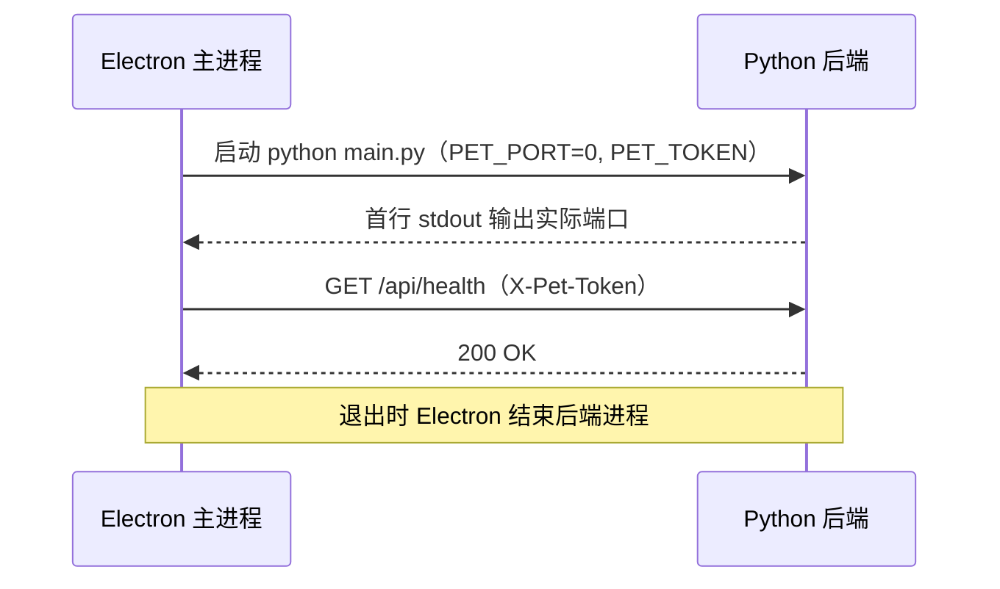

# 桌面宠物 · M0 骨架任务

> 用途：每轮沟通前列出本轮计划，沟通后更新状态，并作为工作单跟踪进度。
> 需求与技术选型以 `桌面宠物PRD.md` 为准，架构以 `Arch.md` 为准。
> 状态标记：⬜ 待办 · 🔄 进行中 · ✅ 已完成 · ⏸ 阻塞
> 任务编号格式 `T-NNN`，按创建顺序递增，不复用；每个任务完成后在 §七 填写产出与提交号。

## 一、业务背景与目标

### 业务问题

桌面宠物是一个自用的桌面陪伴型 Chat Agent，需要前后端分离的稳定骨架，才能在后续里程碑（M1–M6）中逐步加入对话、记忆、天气、主动消息与受限能力。

### 已确认需求

- 形态：自用，不对外发布；平台 Windows 11。
- 桌面壳为 Electron（主进程 TypeScript），后端为 Python 3.12 + FastAPI + uvicorn。
- 前后端仅通过本地 REST 与 WebSocket 通信，后端只监听 `127.0.0.1`。
- 配置使用环境变量与 `.env`；依赖分别用 npm 与 uv 管理；版本用 Git 管理。
- 暂不打包，直接使用项目虚拟环境运行。

### 目标

完成 M0「骨架」：Electron 拉起 Python 后端，完成端口握手、令牌鉴权、健康检查与数据库迁移，为 M1 做准备。

### 已完成前置工作

| 编号 | 内容 | 完成日期 | 提交 |
|---|---|---|---|
| T-000-a | 撰写 PRD 初稿（v0.3） | 2026-10-24 | 3c45015 之前 |
| T-000-b | 技术栈调整为 Electron + Python 后端（v0.4） | 2026-10-24 | 3c45015 之前 |
| T-000-c | Python 3.12、LangChain、uv、Git、环境变量约定（v0.5） | 2026-10-24 | 3c45015 |
| T-000-d | 初始化 Git 仓库，编写 Arch.md / README.md / .env.example / .gitignore | 2026-10-24 | 3c45015 |
| T-000-e | 文档职责重划分：PRD 管需求与选型，README 管介绍，Arch 管架构，Task 管计划 | 2026-10-24 | ed86ee6 |
| T-000-f | 确定前端技术栈：React + Vite + Tailwind + Zustand | 2026-10-24 | 19e29a9 |
| T-000-g | 架构调整：前端 `frontend/`、后端 `backend/`（不设 pet_backend），infra / service / capabilities 分层，前端 OpenAPI 契约生成，`.env` 与人设迁入 `backend/config/`（Arch v0.3） | 2026-10-24 | 41d8689 |

## 二、当前业务工作流（mermaid）[可选]

## 三、审查结论

- 文档职责已划分清楚：PRD 管需求与选型，README 管介绍，Arch 管前后端架构，Task 管计划与进度。
- 技术栈已全部确定，M0 无阻塞于选型。
- D-2 已确认：引入 ruff 与 pre-commit（T11 已完成）。M0 当前没有决策阻塞项。

## 四、非目标

- 不实现 M1 及以后的功能：对话、记忆、天气、主动消息、能力扩展、聊天记录导入。
- 不做 PyInstaller 或 electron-builder 打包。
- 不做 UI 细节（悬浮形象动画、设置页内容），只保证连通。
- 不做 LLM 调用的质量评估。

## 五、待确认问题与风险

1. ~~**D-2 是否引入 `ruff` 与 `pre-commit`**~~：已确认，见 T11。
2. **D-3 和风天气的鉴权方式与凭据格式**（影响 M3，不阻塞 M0）。
3. **D-4 `backend/config/persona.yaml` 是否入 Git**（不阻塞，可先入 Git）。
4. **架构待确认**：infra 与 service 的划分标准、Zustand store 位置、api-contracts.json 生成方式，见 Arch §10。
4. **风险：Electron 与 Python 进程的生命周期联动**。若 Electron 异常退出，后端可能残留。应对：后端单实例锁 + 监控退出（T8、T9）。
5. **风险：端口握手依赖 stdout 首行格式**。应对：约定首行格式固定，并在 T10 中验证。

## 六、已确认口径

以下口径已确认，实施中不再改动；如需变更，先在 §五 登记。

- 前端：React + Vite（electron-vite）+ Tailwind CSS + Zustand。Zustand store 仅作为每个窗口的展示缓存，数据源为后端。
- 后端：Python 3.12、FastAPI、uvicorn、SQLite（`sqlite3`）、LangChain（`langchain-openai`）。
- 后端只监听 `127.0.0.1`，所有请求带 `X-Pet-Token`。
- 配置：环境变量优先，`backend/config/.env` 为本地来源；`.env` 不入 Git。配置文件统一放在 `backend/config/`。
- 目录：前端根目录 `frontend/`，后端根目录 `backend/`，后端不设 `pet_backend` 包。
- 依赖：前端 npm，后端 uv（`pyproject.toml` + `uv.lock`）。
- 运行：使用项目虚拟环境直接运行，暂不打包。
- 版本：Git 管理，里程碑打 tag（如 `m0-skeleton`）。
- 代码检查：ruff（格式化与检查），由 pre-commit 在提交前自动运行。
- LLM 配置：`.env` 提供 `LLM_PROVIDERS`（当前为 `deepseek,opencode`）、`<PROVIDER>_BASE_URL`、`DEFAULT_CHAT_MODEL`、`DEFAULT_CONSOLIDATE_MODEL`（当前为 `deepseek-flash`）；opencode 使用 OpenCode Go 地址 `https://opencode.ai/zen/go/v1`，`llm.yaml` 中为其配置 `request_header`（`x-opencode-session`）；解析规则见 `backend/config/README.md`；密钥从系统环境变量 `<PROVIDER>_API_KEY` 读取，不写入文件；`llm.yaml` 提供模型预设；配置支持热更新（变化检测 + 手动重载 + 原子替换）。详见 Arch §8.3。
- 提交信息前缀：`feat:`、`fix:`、`docs:`、`refactor:`、`chore:`、`test:`。

## 七、实施任务与依赖

### T1. 确定前端技术栈（T-001）

**目的**：明确 Electron 渲染进程的框架与工具，解除前端骨架任务的阻塞。

**状态**：已完成。决策已记入 PRD 技术选型与 Arch §1.2。

**范围**：框架选择（React / Vue）、样式方案、状态管理方案。

**验收**：PRD、Arch 与本文件口径一致，不再存在“待定”描述。

**验证结果**：已完成。PRD、Arch 已更新，提交 19e29a9。

### T2. 创建后端项目（T-002）

**目的**：建立 Python 3.12 的 uv 项目，锁定依赖。

**状态**：已完成。依赖已全部安装并锁定。

**范围**：`backend/pyproject.toml` 写入运行时依赖：fastapi、uvicorn、pydantic-settings、langchain、langchain-openai、httpx、pyyaml；开发依赖：pytest。

**验收**：`uv sync` 在 `backend/` 下成功，生成 `uv.lock`，`.venv` 使用 Python 3.12。

**验证结果**：已验证。`.venv` 为 Python 3.12.12；运行时依赖 fastapi、uvicorn、pydantic-settings、langchain、langchain-openai、httpx、pyyaml 与开发依赖 pytest、ruff、pre-commit 均已写入 `pyproject.toml` 并锁定在 `uv.lock`；`uv run python -c "import ..."` 导入全部通过。

### T3. 配置模块（T-003）

**目的**：统一读取与校验环境变量，防止误配置为对外地址。

**状态**：待办。依赖 T2。

**范围**：`backend/config/settings.py` 中的 `Settings`，读取 `backend/config/.env` 与环境变量；`PET_HOST` 只允许 `127.0.0.1`，其他值启动报错。

**验收**：`PET_HOST=0.0.0.0` 时启动失败并给出明确错误；缺少 `PET_TOKEN` 时启动失败。

**验证结果**：未执行。

### T4. 启动入口与端口握手（T-004）

**目的**：让 Electron 能拿到后端实际端口。

**状态**：待办。依赖 T3。

**范围**：`backend/main.py` 启动 uvicorn，`backend/api/app.py` 中 `create_app()`；`PET_PORT=0` 时随机端口，首行 stdout 输出端口。

**验收**：启动后首行输出形如 `PET_PORT=<端口>`，端口可被访问。

**验证结果**：未执行。

### T5. 令牌鉴权与健康检查（T-005）

**目的**：保证只有持有令牌的客户端可访问后端。

**状态**：待办。依赖 T4。

**范围**：鉴权中间件校验 `X-Pet-Token`；`GET /api/health`。

**验收**：无令牌或错误令牌返回统一错误结构 `{ "error": { "code", "message" } }`；正确令牌返回 200。

**验证结果**：未执行。

### T6. 数据库连接与迁移（T-006）

**目的**：建立 SQLite 存储基础，后续表结构统一由迁移管理。

**状态**：待办。依赖 T2。

**范围**：`backend/infra/store/db.py`（WAL、外键）、`backend/infra/store/migrate.py`（按序号执行，记录 `schema_version`）、`backend/infra/store/migrations/0001_init.sql`（表结构见 PRD §7.7）。

**验收**：首次启动生成 `data/pet.db`，重复启动不重复执行迁移。

**验证结果**：未执行。

### T7. 日志（T-007）

**目的**：便于排查问题，日志只写本地。

**状态**：待办。依赖 T4。

**范围**：`backend/infra/logging.py`，日志写入 `backend/data/logs/`，级别由 `PET_LOG_LEVEL` 控制。

**验收**：启动与请求会写入日志文件；`PET_LOG_LEVEL` 生效。

**验证结果**：未执行。

### T8. 单实例锁（T-008）

**目的**：防止后端重复启动导致端口与数据库冲突。

**状态**：待办。依赖 T4。

**范围**：`backend/data/backend.lock`，启动时加锁，退出时释放。

**验收**：已有实例运行时，第二次启动报错退出。

**验证结果**：未执行。

### T9. Electron 骨架（T-009）

**目的**：由桌面端统一拉起与关闭后端。

**状态**：待办。依赖 T1（已完成）、T4。

**范围**：`frontend/` 使用 electron-vite；主进程 `frontend/electron/main/backend/launcher.ts` 启动后端、读取端口；`supervisor.ts` 监控退出并联动关闭；`frontend/electron/preload/index.ts` 通过 contextBridge 暴露后端地址与令牌。

**验收**：`npm run dev` 启动时自动拉起后端；关闭 Electron 后后端进程随之结束。

**验证结果**：未执行。

### T10. 前端调通健康检查（T-010）

**目的**：验证前后端端到端连通。

**状态**：待办。依赖 T5、T9。

**范围**：`backend/scripts/export_openapi.py` 导出 `backend/openapi.json`；`frontend/scripts/gen-api-contracts.ts`（`npm run gen:api`）生成 `frontend/src/api/api-contracts.json`；`frontend/src/api/client.ts` 调用 `/api/health`，在窗口中显示结果。

**验收**：窗口显示后端健康状态；令牌错误时显示错误信息。

**验证结果**：未执行。

### T11. 代码检查工具（T-011）

**目的**：统一代码风格，尽早发现问题。

**状态**：已完成。D-2 已确认引入。

**范围**：`backend/pyproject.toml` 的 `[tool.ruff]` 配置（行宽 100，py312，规则 E/F/I/B/UP）；根目录 `.pre-commit-config.yaml`，本地钩子通过 `uv run` 调用 ruff；`pre-commit install` 写入 `.git/hooks/pre-commit`。

**验收**：`uv run pre-commit run --all-files` 可执行；对有问题的 Python 文件，`ruff check` 能报错。

**验证结果**：已验证。`uv run pre-commit install` 成功；`pre-commit run --all-files` 因暂无 Python 源码显示 Skipped；使用临时文件（含未使用导入与未排序导入）测试 `ruff check`，报出 F401 与 I001，测试文件已删除。提交 ea51920。Windows 下中文路径导致钩子路径乱码，已用 `PYTHONUTF8=1` 重装解决，记录于 README。

### T12. 里程碑收尾（T-012）

**目的**：标记 M0 完成，便于回溯。

**状态**：待办。依赖 T1–T11。

**范围**：更新 `README.md` 当前进度，提交，打 tag `m0-skeleton`。

**验收**：`git tag` 中存在 `m0-skeleton`，README 进度与实际一致。

**验证结果**：未执行。

### T13. LLM 配置加载、校验与热更新（T-013）

**目的**：让模型 provider 与模型预设可配置、可校验，并支持不重启切换。

**状态**：🔄 进行中。解析、校验、热更新逻辑已完成（见 T15）；HTTP 接口待 T5 的 API 层接入。

**范围**：
- `backend/config/settings.py`：`load_model_settings()` 解析 `.env` 与 `llm.yaml`，产出 `ModelSettings`（见 `backend/config/README.md` §10）。已完成。
- `backend/service/llm/llm_service.py`：`LlmService` 持有快照、变化检测、原子替换、手动重载。已完成。
- `backend/api/routers/llm.py`：`GET /api/llm/providers`、`POST /api/llm/reload`，依赖 T5 的 API 层。`GET/PUT /api/llm/active` 放到 M1 与模型网关一起实现。

**验收**：
- 缺少 `
_BASE_URL` 或 `
_API_KEY`、provider 不在 `llm.yaml` 中、默认模型不存在、api_key 值疑似密钥字面量时，启动或重载失败并给出明确错误。
- 修改 `llm.yaml` 后调用 `POST /api/llm/reload`，`GET /api/llm/providers` 立即反映新结果；配置有误时返回错误，旧配置仍生效。
- 响应中不出现任何密钥值。
- 单元测试覆盖：解析、校验失败分支、版本变化、失败不替换旧快照。

**验证结果**：未执行。

### T14. LLM 三种接口范式（T-014）

**目的**：基于 LangChain 提供三种接口范式：`chat_completions`、`responses`、`messages`，供 provider 的模型按 `api` 字段选择。

**状态**：已完成。范式名称已统一为三个值（见 T15）。

**范围**：
- 依赖：新增 `langchain-anthropic`（`uv add`），`langchain-openai` 已在 T2 中引入。
- `backend/infra/llm/spec.py`：`ApiParadigm`（`chat_completions` / `responses` / `messages`）与 `ModelSpec`（API 密钥不出现在 repr 中）。
- `backend/infra/llm/paradigms.py`：`build_chat_model(spec)` 按范式构造 `ChatOpenAI` 或 `ChatAnthropic`；`anthropic_root_url` 去掉 `/v1`。
- `backend/config/llm.yaml`：每个模型新增 `api` 字段；opencode 增加 `gpt-5.6-luna`（responses）与 `claude-haiku-5-5`（messages）。
- `backend/config/README.md` §6.5：范式说明。

**验收**：三种范式返回正确的 LangChain 类型，请求头与 base_url 正确传入；密钥不出现在 repr 中。

**验证结果**：`uv run pytest` 9 项通过（含 `tests/infra/test_paradigms.py`）；`ruff check` 通过。已用 opencode Go 地址确认三条接口路径可达（带 `x-opencode-session` 时返回服务端错误而非路由错误），未做带密钥的真实调用。

### T15. model_settings 解析与 LLM 服务装配（T-015）

**目的**：`settings.py` 把 `.env` 与 `llm.yaml` 解析为 `model_settings`；服务层用 `model_settings` 装配 client，并支持热更新。

**状态**：已完成。

**范围**：
- `backend/config/settings.py`：`load_model_settings()` 与 `ModelSettingsSource`（变化检测用的文件戳）。包括 `.env` 解析、provider 与模型校验、默认模型解析（按模型标签 `name` 查找，`id` 为上游标识）、版本哈希。
- `backend/service/llm/llm_service.py`：`LlmService` 持有 `ModelSettings` 快照；`client_for(capability)` 按快照装配并缓存 client；`reload()` 手动重载；文件变化在下一次调用时自动重载；解析失败保留旧快照。
- 范式名称统一为 `chat_completions`、`responses`、`messages`（`backend/infra/llm/spec.py`、`paradigms.py`、`config/llm.yaml`、`config/README.md`）。
- 依赖：无新增。

**验收**：
- 解析错误（密钥写入 `.env`、provider 未定义、base_url 缺失、范式名非法、roles 非法、温度越界、模型标签 name 在 provider 内重复、默认模型歧义或角色不符）全部报错，错误一次性汇总。
- 密钥缺失为警告，对应 provider 不可用，调用时返回明确错误。
- `ModelSettings` 与 `repr` 中不出现密钥值。
- 文件变化后下一次调用重新装配；重载失败时旧 client 与旧配置仍可用。

**验证结果**：`uv run pytest` 37 项通过（`tests/config/test_settings.py` 19 项，`tests/service/test_llm_service.py` 9 项，`tests/infra/test_paradigms.py` 9 项）；`ruff check` 通过。装配使用注入的假 builder 测试，未做真实模型调用。

## 八、推荐执行顺序

1. T2：创建后端项目（依赖 uv）。
2. T3 → T4：配置与启动入口。
3. T5、T6、T7、T8、T13：并行推进（均依赖 T2–T4，T13 依赖 T3）。
4. T9：Electron 骨架。
5. T10：端到端连通。
6. T11：已完成。
7. T12：收尾并打 tag。

下一步：执行 T3（配置模块）。
