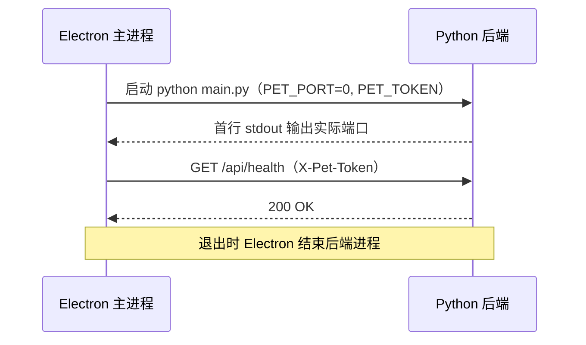

# 桌面宠物 · M0 骨架任务

> 用途：每轮沟通前列出本轮计划，沟通后更新状态，并作为工作单跟踪进度。
> 需求与技术选型以 `桌面宠物PRD.md` 为准，架构以 `Arch.md` 为准。
> 状态标记：⬜ 待办 · 🔄 进行中 · ✅ 已完成 · ⏸ 阻塞
> 任务编号格式 `T-NNN`，按创建顺序递增，不复用；每个任务完成后在 §七 填写产出与提交号。

## 一、业务背景与目标

### 业务问题

桌面宠物是一个自用的桌面陪伴型 Chat Agent，需要前后端分离的稳定骨架，才能在后续里程碑（M1–M6）中逐步加入对话、记忆、天气、主动消息与受限能力。

### 已确认需求

- 形态：自用，不对外发布；平台 Windows 11。
- 桌面壳为 Electron（主进程 TypeScript），后端为 Python 3.12 + FastAPI + uvicorn。
- 前后端仅通过本地 REST 与 WebSocket 通信，后端只监听 `127.0.0.1`。
- 配置使用环境变量与 `.env`；依赖分别用 npm 与 uv 管理；版本用 Git 管理。
- 暂不打包，直接使用项目虚拟环境运行。

### 目标

完成 M0「骨架」：Electron 拉起 Python 后端，完成端口握手、令牌鉴权、健康检查与数据库迁移，为 M1 做准备。

### 已完成前置工作

| 编号 | 内容 | 完成日期 | 提交 |
|---|---|---|---|
| T-000-a | 撰写 PRD 初稿（v0.3） | 2026-10-24 | 3c45015 之前 |
| T-000-b | 技术栈调整为 Electron + Python 后端（v0.4） | 2026-10-24 | 3c45015 之前 |
| T-000-c | Python 3.12、LangChain、uv、Git、环境变量约定（v0.5） | 2026-10-24 | 3c45015 |
| T-000-d | 初始化 Git 仓库，编写 Arch.md / README.md / .env.example / .gitignore | 2026-10-24 | 3c45015 |
| T-000-e | 文档职责重划分：PRD 管需求与选型，README 管介绍，Arch 管架构，Task 管计划 | 2026-10-24 | ed86ee6 |
| T-000-f | 确定前端技术栈：React + Vite + Tailwind + Zustand | 2026-10-24 | 19e29a9 |
| T-000-g | 架构调整：前端 `frontend/`、后端 `backend/`（不设 pet_backend），infra / service / capabilities 分层，前端 OpenAPI 契约生成，`.env` 与人设迁入 `backend/config/`（Arch v0.3） | 2026-10-24 | 41d8689 |

## 二、当前业务工作流（mermaid）[可选]

## 三、审查结论

- 文档职责已划分清楚：PRD 管需求与选型，README 管介绍，Arch 管前后端架构，Task 管计划与进度。
- 技术栈已全部确定，M0 无阻塞于选型。
- D-2 已确认：引入 ruff 与 pre-commit（T11 已完成）。M0 当前没有决策阻塞项。

## 四、非目标

- 不实现 M1 及以后的功能：对话、记忆、天气、主动消息、能力扩展、聊天记录导入。
- 不做 PyInstaller 或 electron-builder 打包。
- 不做 UI 细节（悬浮形象动画、设置页内容），只保证连通。
- 不做 LLM 调用的质量评估。

## 五、待确认问题与风险

1. ~~**D-2 是否引入 `ruff` 与 `pre-commit`**~~：已确认，见 T11。
2. **D-3 和风天气的鉴权方式与凭据格式**（影响 M3，不阻塞 M0）。
3. **D-4 `backend/config/persona.yaml` 是否入 Git**（不阻塞，可先入 Git）。
4. **架构待确认**：infra 与 service 的划分标准、Zustand store 位置、api-contracts.json 生成方式，见 Arch §10。
4. **风险：Electron 与 Python 进程的生命周期联动**。若 Electron 异常退出，后端可能残留。应对：后端单实例锁 + 监控退出（T8、T9）。
5. **风险：端口握手依赖 stdout 首行格式**。应对：约定首行格式固定，并在 T10 中验证。

## 六、已确认口径

以下口径已确认，实施中不再改动；如需变更，先在 §五 登记。

- 前端：React + Vite（electron-vite）+ Tailwind CSS + Zustand。Zustand store 仅作为每个窗口的展示缓存，数据源为后端。
- 后端：Python 3.12、FastAPI、uvicorn、SQLite（`sqlite3`）、LangChain（`langchain-openai`）。
- 后端只监听 `127.0.0.1`，所有请求带 `X-Pet-Token`。
- 配置：环境变量优先，`backend/config/.env` 为本地来源；`.env` 不入 Git。配置文件统一放在 `backend/config/`。
- 目录：前端根目录 `frontend/`，后端根目录 `backend/`，后端不设 `pet_backend` 包。
- 依赖：前端 npm，后端 uv（`pyproject.toml` + `uv.lock`）。
- 运行：使用项目虚拟环境直接运行，暂不打包。
- 版本：Git 管理，里程碑打 tag（如 `m0-skeleton`）。
- 代码检查：ruff（格式化与检查），由 pre-commit 在提交前自动运行。
- LLM 配置：`.env` 提供 `LLM_PROVIDERS`（当前为 `deepseek,opencode`）、`<PROVIDER>_BASE_URL`、`DEFAULT_CHAT_MODEL`、`DEFAULT_CONSOLIDATE_MODEL`（当前为 `deepseek-flash`）；opencode 使用 OpenCode Go 地址 `https://opencode.ai/zen/go/v1`，`llm.yaml` 中为其配置 `request_header`（`x-opencode-session`）；解析规则见 `backend/config/README.md`；密钥从系统环境变量 `<PROVIDER>_API_KEY` 读取，不写入文件；`llm.yaml` 提供模型预设；配置支持热更新（变化检测 + 手动重载 + 原子替换）。详见 Arch §8.3。
- 提交信息前缀：`feat:`、`fix:`、`docs:`、`refactor:`、`chore:`、`test:`。

## 七、实施任务与依赖

### T1. 确定前端技术栈（T-001）

**目的**：明确 Electron 渲染进程的框架与工具，解除前端骨架任务的阻塞。

**状态**：已完成。决策已记入 PRD 技术选型与 Arch §1.2。

**范围**：框架选择（React / Vue）、样式方案、状态管理方案。

**验收**：PRD、Arch 与本文件口径一致，不再存在“待定”描述。

**验证结果**：已完成。PRD、Arch 已更新，提交 19e29a9。

### T2. 创建后端项目（T-002）

**目的**：建立 Python 3.12 的 uv 项目，锁定依赖。

**状态**：已完成。依赖已全部安装并锁定。

**范围**：`backend/pyproject.toml` 写入运行时依赖：fastapi、uvicorn、pydantic-settings、langchain、langchain-openai、httpx、pyyaml；开发依赖：pytest。

**验收**：`uv sync` 在 `backend/` 下成功，生成 `uv.lock`，`.venv` 使用 Python 3.12。

**验证结果**：已验证。`.venv` 为 Python 3.12.12；运行时依赖 fastapi、uvicorn、pydantic-settings、langchain、langchain-openai、httpx、pyyaml 与开发依赖 pytest、ruff、pre-commit 均已写入 `pyproject.toml` 并锁定在 `uv.lock`；`uv run python -c "import ..."` 导入全部通过。

### T3. 配置模块（T-003）

**目的**：统一读取与校验环境变量，防止误配置为对外地址。

**状态**：已完成。依赖 T2。

**范围**：`backend/config/settings.py` 的 `load_service_settings()` 与 `ServiceSettings`，读取 `backend/config/.env` 与环境变量（环境变量优先）；`PET_HOST` 只允许 `127.0.0.1`；`PET_TOKEN` 必填；其余 `PET_*` 变量按 `backend/config/README.md` §11 校验。新增依赖 `tzdata`（Windows 缺少系统时区库，`zoneinfo` 无法解析 `Asia/Shanghai`）。

**验收**：`PET_HOST=0.0.0.0` 时启动失败并给出明确错误；缺少 `PET_TOKEN` 时启动失败。

**验证结果**：已验证。`tests/config/test_service_settings.py` 新增 25 项，覆盖默认值、非回环地址拒绝、令牌缺失与空值、优先级、端口、时区、日志级别、勿扰时段、多错误汇总、令牌不出现在 repr 中。`uv run pytest` 共 64 项通过，`ruff check` 通过。

### T4. 启动入口与端口握手（T-004）

**目的**：让 Electron 能拿到后端实际端口。

**状态**：已完成。依赖 T3。

**范围**：`backend/main.py` 加载 `ServiceSettings`，先绑定 `PET_HOST:PET_PORT`，首行 stdout 输出 `PET_PORT=<实际端口>`，再把同一个 socket 交给 uvicorn（`PET_PORT=0` 时端口由系统分配，输出的即为服务实际监听的端口）；`backend/api/app.py` 中 `create_app()`。配置错误、端口被占用时输出到 stderr 并以退出码 1 结束，stdout 无输出。stdout 与 stderr 强制 UTF-8。

**验收**：启动后首行输出形如 `PET_PORT=<端口>`，端口可被访问。

**验证结果**：已验证。`tests/test_main.py` 7 项通过：首行输出端口、该端口可访问（返回 404，应用尚无路由）、固定端口、`PET_HOST=0.0.0.0` 退出码 1、缺少 `PET_TOKEN` 退出码 1、端口被占用退出码 1。`uv run pytest` 共 71 项通过，`ruff check` 通过。

**验证结果**：未执行。

### T5. 令牌鉴权与健康检查（T-005）

**目的**：保证只有持有令牌的客户端可访问后端。

**状态**：已完成。依赖 T4。

**范围**：
- `backend/api/auth.py`：纯 ASGI 的 `TokenAuthMiddleware`，同时覆盖 HTTP 与 WebSocket；使用 `hmac.compare_digest` 比较令牌。
- `backend/api/errors.py`：统一错误结构；HTTP 404、405、参数校验错误也使用同一结构。
- `backend/api/routers/system.py`：`GET /api/health`，`operationId` 为 `health`。
- `create_app(token)` 挂载路由、错误处理与鉴权中间件；`main.py` 传入 `PET_TOKEN`。

**验收**：无令牌或错误令牌返回统一错误结构 `{ "error": { "code", "message" } }`；正确令牌返回 200。

**验证结果**：已验证。`tests/api/test_auth.py` 新增 11 项：正确令牌返回 200、缺失与错误令牌返回 401、空令牌、请求头名大小写不敏感、未知路径未鉴权时不泄露路由、已鉴权的 404 与 405 统一结构、WebSocket 缺失或错误令牌以 1008 关闭。`tests/test_main.py` 的端到端用例同步更新为未鉴权返回 401、带令牌返回 200。`uv run pytest` 共 81 项通过，`ruff check` 通过。

**验证结果**：未执行。

### T6. 数据库连接与迁移（T-006）

**目的**：建立 SQLite 存储基础，后续表结构统一由迁移管理。

**状态**：已完成。依赖 T2。

**范围**：
- `backend/infra/store/db.py`：`connect()`（WAL、外键、忙等待）、`transaction()`（`BEGIN IMMEDIATE`，异常时回滚）。
- `backend/infra/store/migrate.py`：`load_migrations()` 校验文件名与连续编号；`migrate()` 按序执行未应用的迁移，`schema_version` 记录 SHA-256；已应用文件被修改、存在未知版本时报错；`split_statements()` 按完整语句拆分迁移。
- `backend/infra/store/migrations/0001_init.sql`：按 PRD §7.7 建表（`llm_provider` 不入库，新增 `app_setting`，`llm_usage` 增加 `success`，`capability_run` 增加 `undo_payload`）。
- `backend/main.py`：启动时调用 `initialize_database(settings.data_dir)`，位于端口绑定之前；失败时输出到 stderr 并以退出码 1 结束。

**验收**：首次启动生成 `data/pet.db`，重复启动不重复执行迁移。

**验证结果**：已验证。`tests/infra/test_store.py` 新增 19 项：WAL 与外键、首次迁移建表、重复迁移无操作、校验和记录、外键与 CHECK 约束、事务回滚、迁移失败回滚、已应用文件被修改、未知版本、编号不连续、文件名不合法、语句拆分。`tests/test_main.py` 新增 2 项：启动创建数据库、数据目录不可用时退出码为 1。`uv run pytest` 共 100 项通过，`ruff check` 通过。

### T7. 日志（T-007）

**目的**：便于排查问题，日志只写本地。

**状态**：已完成。依赖 T4。

**范围**：
- `backend/infra/logging.py`：`setup_logging(level, log_dir)` 在根 logger 上挂载 `RotatingFileHandler`，文件为 `<log_dir>/backend.log`，单文件 5 MB，保留 5 份，UTF-8 编码。重复调用不会重复添加处理器。
- `backend/main.py`：日志目录为 `PET_DATA_DIR/logs`（随数据目录配置）；启动、数据库迁移结果、监听地址、退出均写入日志。
- uvicorn 使用 `log_config=None` 且不传 `log_level`，访问日志沿用根 logger 的配置，写入同一文件。
- 日志只写文件，不写 stdout；stdout 第一行仍是 `PET_PORT=<端口>`。令牌不写入日志。

**验收**：启动与请求会写入日志文件；`PET_LOG_LEVEL` 生效。

**验证结果**：已验证。`tests/infra/test_logging.py` 新增 5 项：创建日志文件、级别过滤、根 logger 级别、重复配置不重复输出、UTF-8 写入。`tests/test_main.py` 新增 2 项：`INFO` 级别下启动与请求写入日志且令牌不出现在日志中；`ERROR` 级别下不写入启动与访问日志。`uv run pytest` 共 107 项通过，`ruff check` 通过。

**扩展：日志入库（DbLogHandler）**
- 迁移 `0002_log_record.sql` 新增 `log_record` 表。
- `infra/logging.py` 的 `DbLogHandler`：有界队列加后台线程批量写入；队列满时丢弃并计数；`close()` 写完剩余记录。
- `main.py` 在数据库迁移完成后挂载处理器，退出前关闭。
- 验证：`tests/infra/test_db_log.py` 新增 11 项，覆盖入库、时间格式、异常文本、按时间与批量刷新、关闭时排空、队列满时不阻塞、关闭后忽略、数据库不可用时不影响日志调用、重复挂载替换。`tests/infra/test_store.py` 更新为两个迁移。`tests/test_main.py` 新增端到端用例，验证日志确实写入数据库。`uv run pytest` 共 118 项通过。
- 注意：进程被强制结束（Windows 上的 `TerminateProcess`）时，尚未写入的记录会丢失，最多为一个未满批次的内容。
- 批次规则调整：批次满 `queue_size`（默认 20，`PET_LOG_QUEUE_SIZE`）条，或自批次第一条起超过 `max_wait_seconds`（默认 30 秒，`PET_LOG_MAX_WAIT_SECONDS`）即封口写入；封口后进入下一批次，生产方不阻塞。参数由构造函数传入，配置层提供默认值。
- 验证：`tests/infra/test_db_log.py` 共 15 项（新增队列满写入、超时前不写入、超时后进入下一批次、满队列时生产方不阻塞、参数校验等）；`tests/config/test_service_settings.py` 新增 7 项；`uv run pytest` 共 129 项通过。连续运行 3 次结果一致。
- 待确认：强制结束会丢失未满批次的日志，建议实现优雅退出（如 stdin 关闭或 `/api/shutdown`），以便退出前调用 `close()`。

### T8. 单实例锁（T-008）

**目的**：防止后端重复启动导致端口与数据库冲突。

**状态**：已完成。依赖 T4。

**范围**：
- `backend/infra/lock.py`：`SingleInstanceLock` 使用操作系统级别的文件锁（Windows 为 `msvcrt.locking`，其他平台为 `fcntl.flock`）。锁由进程持有，进程结束时系统自动释放，包括被强制结束或崩溃的情况，因此残留的锁文件不会阻止启动。
- 锁文件为 `PET_DATA_DIR/backend.lock`，锁住第 0 个字节；PID 写在第 1 个字节之后，仅用于错误提示。
- `backend/main.py`：在数据库迁移之前获取锁，整个服务运行期间持有，退出时释放。已有实例运行时，本实例输出错误到 stderr 并以退出码 1 结束，不触碰数据库。

**验收**：已有实例运行时，第二次启动报错退出。

**验证结果**：已验证。`tests/infra/test_lock.py` 新增 6 项：第二个持有者被拒绝并报告 PID、释放后可重新获取、残留的锁文件不阻塞、上下文管理器释放、未获取时释放为空操作、自动创建父目录。`tests/test_main.py` 新增 3 项：同一数据目录第二个实例退出码为 1 且第一个实例不受影响；优雅退出后锁被释放；强制结束后锁被系统释放，新实例可以启动。`uv run pytest` 共 149 项通过，连续运行两次结果一致。

### T9. Electron 骨架（T-009）

**目的**：由桌面端统一拉起与关闭后端。

**状态**：已完成。依赖 T1（已完成）、T4。

**范围**：
- `frontend/`：electron-vite 6、Electron 45、Vite 8、React 19、TypeScript、Vitest。`electron.vite.config.ts` 分别构建 main、preload、renderer。
- `frontend/electron/main/backend/launcher.ts`：`launchBackend()` 以 `stdio: pipe` 拉起 `backend/.venv` 中的 Python（可用 `PET_PYTHON` 覆盖），生成随机令牌（`PET_TOKEN`），读取首行 `PET_PORT=<端口>`；超时或启动前退出时报错，并附带 stderr 末尾内容。
- `frontend/electron/main/backend/supervisor.ts`：`BackendSupervisor.stop()` 通过 stdin 发送 `shutdown` 指令，超时后强制结束；意外退出时回调通知。
- `frontend/electron/main/index.ts`：启动后端 → 注册 IPC → 创建窗口；`before-quit` 时先优雅停止后端再退出；后端意外退出时提示并关闭应用。
- `frontend/electron/preload/index.ts`：contextBridge 暴露 `window.petBackend.getInfo()`，仅返回端口与令牌。
- `frontend/src/app/entries/pet.html` / `pet.tsx`：最小窗口，显示后端连接状态。

**验收**：`npm run dev` 启动时自动拉起后端；关闭 Electron 后后端进程随之结束。

**验证结果**：已验证。
- `npx tsc --noEmit` 通过；`electron-vite build` 通过。
- `npx vitest run` 共 11 项通过，包括对真实 Python 后端的集成测试：带令牌的 `/api/health` 返回 200，不带令牌返回 401，`stop()` 后退出码为 0。
- 真实 Electron 运行：后端随应用启动，日志写入“后端已启动”；关闭主窗口（等同用户关闭）后，Electron 通过 stdin 发送 `shutdown`，后端经优雅退出写完日志（退出原因：stdin 指令），后端与 Electron 进程均结束。

**过程中发现并修复的问题**：
1. 端口竞争：原先先打印 `PET_PORT` 再 `listen`，客户端可能在 listen 之前连接而被拒绝。修复：绑定后立即 `sock.listen()`，再打印端口。
2. 渲染产物位置错误：`outDir` 使用相对路径，输出到了仓库根目录的 `out/`。改为基于配置文件的绝对路径。
3. Electron 二进制未随 `npm install` 下载，手动执行 `node node_modules/electron/install.js` 后正常。

**已知限制（Windows 进程模型）**：父进程被异常结束（任务管理器、崩溃）时，仍在运行的子进程会被系统一并结束，后端无法完成优雅退出，未写入的日志会丢失（最多一个未满批次）。已用对照实验验证：普通子进程在收到 EOF 后若尚未结束，父进程退出即被结束。正常关闭路径不受影响。单实例锁由系统在进程结束时释放，因此异常退出后仍可立即重新启动。

### T10. 前端调通健康检查（T-010）

**目的**：验证前后端端到端连通。

**状态**：已完成。依赖 T5、T9。

**范围**：
- `backend/scripts/export_openapi.py`：导出 `backend/openapi.json`（`python -m scripts.export_openapi`，输出确定性排序）。
- `frontend/scripts/gen-api-contracts.mts`：先调用后端导出，再把 OpenAPI 的每个 path+method 解析为 `operations`（operationId、方法、路径、请求与各状态码响应的 schema，`$ref` 保留）及 `components`，写入 `frontend/src/api/api-contracts.json`。`npm run gen:api` 生成，`npm run gen:api:check` 检查契约是否与后端一致（不一致时退出码为 1）。
- `frontend/src/api/client.ts`：`createApiClient()` 附带 `X-Pet-Token`，把后端统一错误结构映射为 `ApiError`（含 status、code）。
- `frontend/src/api/endpoints.ts`：`getHealth()`。
- `frontend/src/service/backend.service.ts`：从 preload 取得端口与令牌，调用 `getHealth()`。
- `frontend/src/app/entries/pet.tsx`：窗口显示“后端正常（端口，状态）”或“后端错误：代码：信息”。

**验收**：窗口显示后端健康状态；令牌错误时显示错误信息。

**验证结果**：已验证。
- 单元测试（`tests/api/client.test.ts`，11 项）：令牌头、错误结构映射、非 JSON 错误、网络错误、契约中 health 操作与请求路径一致、不以客户端为 this 调用 fetch。
- 集成测试（`tests/api/real-backend.test.ts`，2 项）：真实后端返回 `{"status":"ok"}`；错误令牌返回 401 与 `unauthorized`。
- `npm run gen:api:check` 通过；`tsc --noEmit` 通过；`npx vitest run` 共 20 项通过。
- 真实 Electron：渲染进程请求 `/api/health`，后端访问日志为 200；关闭窗口后后端经 stdin 指令优雅退出，应用与后端进程均结束。

**过程中发现并修复的问题**：
1. `createApiClient` 直接保存 `window.fetch` 并以 `client.fetch(...)` 调用，浏览器抛出 `Illegal invocation`。修复：包装一层调用，并增加对应测试。
2. 渲染产物位置错误（同 T9，已修复）。

**已知项**：Electron 提示缺少 Content-Security-Policy（开发模式下的安全警告）。打包前需在 `pet.html` 中加入 CSP，并限制 `connect-src` 为 `http://127.0.0.1:*`。

### T11. 代码检查工具（T-011）

**目的**：统一代码风格，尽早发现问题。

**状态**：已完成。D-2 已确认引入。

**范围**：`backend/pyproject.toml` 的 `[tool.ruff]` 配置（行宽 100，py312，规则 E/F/I/B/UP）；根目录 `.pre-commit-config.yaml`，本地钩子通过 `uv run` 调用 ruff；`pre-commit install` 写入 `.git/hooks/pre-commit`。

**验收**：`uv run pre-commit run --all-files` 可执行；对有问题的 Python 文件，`ruff check` 能报错。

**验证结果**：已验证。`uv run pre-commit install` 成功；`pre-commit run --all-files` 因暂无 Python 源码显示 Skipped；使用临时文件（含未使用导入与未排序导入）测试 `ruff check`，报出 F401 与 I001，测试文件已删除。提交 ea51920。Windows 下中文路径导致钩子路径乱码，已用 `PYTHONUTF8=1` 重装解决，记录于 README。

### T12. 里程碑收尾（T-012）

**目的**：标记 M0 完成，便于回溯。

**状态**：待办。依赖 T1–T11。

**范围**：更新 `README.md` 当前进度，提交，打 tag `m0-skeleton`。

**验收**：`git tag` 中存在 `m0-skeleton`，README 进度与实际一致。

**验证结果**：未执行。

### T13. LLM 配置加载、校验与热更新（T-013）

**目的**：让模型 provider 与模型预设可配置、可校验，并支持不重启切换。

**状态**：🔄 进行中。解析、校验、热更新逻辑已完成（见 T15）；HTTP 接口待 T5 的 API 层接入。

**范围**：
- `backend/config/settings.py`：`load_model_settings()` 解析 `.env` 与 `llm.yaml`，产出 `ModelSettings`（见 `backend/config/README.md` §10）。已完成。
- `backend/service/llm/llm_service.py`：`LlmService` 持有快照、变化检测、原子替换、手动重载。已完成。
- `backend/api/routers/llm.py`：`GET /api/llm/providers`、`POST /api/llm/reload`，依赖 T5 的 API 层。`GET/PUT /api/llm/active` 放到 M1 与模型网关一起实现。

**验收**：
- 缺少 `
_BASE_URL` 或 `
_API_KEY`、provider 不在 `llm.yaml` 中、默认模型不存在、api_key 值疑似密钥字面量时，启动或重载失败并给出明确错误。
- 修改 `llm.yaml` 后调用 `POST /api/llm/reload`，`GET /api/llm/providers` 立即反映新结果；配置有误时返回错误，旧配置仍生效。
- 响应中不出现任何密钥值。
- 单元测试覆盖：解析、校验失败分支、版本变化、失败不替换旧快照。

**验证结果**：未执行。

### T14. LLM 三种接口范式（T-014）

**目的**：基于 LangChain 提供三种接口范式：`chat_completions`、`responses`、`messages`，供 provider 的模型按 `api` 字段选择。

**状态**：已完成。范式名称已统一为三个值（见 T15）。

**范围**：
- 依赖：新增 `langchain-anthropic`（`uv add`），`langchain-openai` 已在 T2 中引入。
- `backend/infra/llm/spec.py`：`ApiParadigm`（`chat_completions` / `responses` / `messages`）与 `ModelSpec`（API 密钥不出现在 repr 中）。
- `backend/infra/llm/paradigms.py`：`build_chat_model(spec)` 按范式构造 `ChatOpenAI` 或 `ChatAnthropic`；`anthropic_root_url` 去掉 `/v1`。
- `backend/config/llm.yaml`：每个模型新增 `api` 字段；opencode 增加 `gpt-5.6-luna`（responses）与 `claude-haiku-5-5`（messages）。
- `backend/config/README.md` §6.5：范式说明。

**验收**：三种范式返回正确的 LangChain 类型，请求头与 base_url 正确传入；密钥不出现在 repr 中。

**验证结果**：`uv run pytest` 9 项通过（含 `tests/infra/test_paradigms.py`）；`ruff check` 通过。已用 opencode Go 地址确认三条接口路径可达（带 `x-opencode-session` 时返回服务端错误而非路由错误），未做带密钥的真实调用。

### T16. 常数层与路径定义（T-016）

**目的**：路径不再散落在各模块中，统一由常数层定义。

**状态**：已完成。

**范围**：
- `backend/constants/path.py`：仅定义目录常量 `BACKEND_DIR`、`ROOT_DIR`、`FRONTEND_DIR`、`CONFIG_DIR`、`DATA_DIR`、`LOG_DIR`、`EXPORT_DIR`、`MIGRATIONS_DIR`，以及 `resolve_from_root()`。具体文件路径在使用处用目录拼接，例如 `CONFIG_DIR / "llm.yaml"`。
- `backend/config/settings.py` 改为引用常数层，不再自行定义路径。
- 测试改为从常数层导入路径。

**验收**：所有目录路径只在 `constants/path.py` 中定义；文件路径不在常量中定义，由目录拼接得到。

**验证结果**：`uv run pytest` 65 项通过，`ruff check` 通过。

### T15. model_settings 解析与 LLM 服务装配（T-015）

**目的**：`settings.py` 把 `.env` 与 `llm.yaml` 解析为 `model_settings`；服务层用 `model_settings` 装配 client，并支持热更新。

**状态**：已完成。

**范围**：
- `backend/config/settings.py`：`load_model_settings()` 与 `ModelSettingsSource`（变化检测用的文件戳）。包括 `.env` 解析、provider 与模型校验、默认模型解析（按模型标签 `name` 查找，`id` 为上游标识）、版本哈希。
- `backend/service/llm/llm_service.py`：`LlmService` 持有 `ModelSettings` 快照；`client_for(capability)` 按快照装配并缓存 client；`reload()` 手动重载；文件变化在下一次调用时自动重载；解析失败保留旧快照。
- 范式名称统一为 `chat_completions`、`responses`、`messages`（`backend/infra/llm/spec.py`、`paradigms.py`、`config/llm.yaml`、`config/README.md`）。
- 依赖：无新增。

**验收**：
- 解析错误（密钥写入 `.env`、provider 未定义、base_url 缺失、范式名非法、roles 非法、温度越界、模型标签 name 在 provider 内重复、默认模型歧义或角色不符）全部报错，错误一次性汇总。
- 密钥缺失为警告，对应 provider 不可用，调用时返回明确错误。
- `ModelSettings` 与 `repr` 中不出现密钥值。
- 文件变化后下一次调用重新装配；重载失败时旧 client 与旧配置仍可用。

**验证结果**：`uv run pytest` 37 项通过（`tests/config/test_settings.py` 19 项，`tests/service/test_llm_service.py` 9 项，`tests/infra/test_paradigms.py` 9 项）；`ruff check` 通过。装配使用注入的假 builder 测试，未做真实模型调用。

### T17. 安全退出机制（T-017）

**目的**：后端能够优雅退出，退出前完成在途请求并把日志队列写完，避免丢失未满批次的日志。

**状态**：已完成。

**范围**：
- `backend/infra/lifecycle.py`：`ShutdownController`（统一的退出入口，重复请求被忽略并保留第一次的原因）；`watch_stdin()`（监听 stdin，`shutdown` 行或 EOF 触发退出）。
- `backend/api/routers/system.py`：`POST /api/shutdown`，需 `X-Pet-Token`，返回 202。
- `backend/main.py`：uvicorn 使用 `timeout_graceful_shutdown=5`；退出后记录原因并关闭数据库日志处理器。
- `Arch.md` §1.3：退出通道与退出过程；Electron 须使用 `stdio: pipe`。

**验收**：三种退出通道（关闭 stdin、`shutdown` 指令、HTTP 接口）均以退出码 0 结束，并把未满批次的日志写入数据库；未鉴权的退出请求被拒绝且后端继续运行。

**验证结果**：已验证。`tests/infra/test_lifecycle.py` 新增 5 项；`tests/api/test_auth.py` 新增 2 项；`tests/test_main.py` 新增 4 项（三种通道参数化，加上未鉴权不退出）。端到端用例的批次等待设为 60 秒，因此日志只能靠退出时的 `close()` 写入，验证了退出路径确实会写完剩余记录。`uv run pytest` 共 140 项通过，连续运行两次结果一致。

## 八、推荐执行顺序

1. T2：创建后端项目（依赖 uv）。
2. T3 → T4：配置与启动入口。
3. T5、T6、T7、T8、T13：并行推进（均依赖 T2–T4，T13 依赖 T3）。
4. T9：Electron 骨架。
5. T10：端到端连通。
6. T11：已完成。
7. T12：收尾并打 tag。

下一步：执行 T3（配置模块）。
