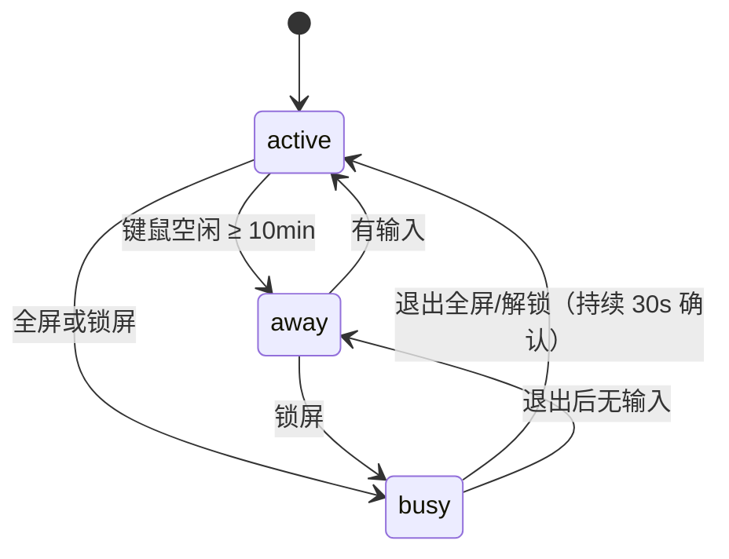

# 感知设计（M4）

> 状态：旧稿（2026-10-29）。分层、契约、阈值归属以 [OBSERVER.md](OBSERVER.md) 为准，主动编排以 [PROACTIVE.md](PROACTIVE.md) 为准。
>
> 本文保留两类内容：**Win32 采集方式与判断条件细节**（OBSERVER.md 不重复），以及**早期主题/话术/节制草案**（已由 OBSERVER.md §5–§7 取代，仅作参考）。
>
> 本文只回答两件事：**感知什么、什么条件下成立**，以及**成立之后能聊什么主题**。
> 不含任务序号与实施排期，排期见 `Task.md`。

## 1. 定位

桌宠的「五官」只回答三个问题：

| 问题 | 能力 | 产出 |
|---|---|---|
| 人在不在 | 键鼠空闲 | `presence`（active / away） |
| 忙不忙 | 全屏 / 锁屏 | `busy`（true / false） |
| 在做什么 | 前台进程、白名单进程启停、时段 | `activity`（结构化事件） |

三条硬约束：

1. **只上报结论，不上报原始输入。** 不记录键值、鼠标坐标、窗口标题、文件内容、URL。
2. **一切感知只落成内存事件。** 九种事件属于 L2 流水，只进上下文；不扩 `EVENT_TYPES`、不写 `daily_log`、不写结构化记忆（§7）。
3. **前端采集、后端决策。** 系统调用在 Tauri（Rust）侧做，后端只接收事实、判定条件、决定是否开口。

## 2. 状态模型



派生一个唯一的口径，后续调度只看它：

```
can_speak = presence == active
         and not busy
         and not in_dnd(now)
         and not chat_in_progress
         and now - last_proactive_at >= min_interval
         and today_count < daily_limit
         and topic_not_used_today
```

`busy` 为真时**一律不主动开口**（用户口径），只在退出忙碌时补一句（见主题表）。

## 3. 采集方式

统一在 Tauri 前端（`frontend/src-tauri`，Rust）采集，变化时 `POST /api/perception` 上报；后端不引入 `psutil` / `pywin32`，也不做后台轮询。

| 能力 | Win32 调用 | 说明 |
|---|---|---|
| 键鼠空闲 | `GetLastInputInfo` | 只读「最后一次输入的时刻」得到全系统空闲毫秒数；不装钩子、不读键值 |
| 前台进程 | `GetForegroundWindow` → `GetWindowThreadProcessId` → `OpenProcess(PROCESS_QUERY_LIMITED_INFORMATION)` → `QueryFullProcessImageNameW` | 只取 exe 文件名（小写、去 `.exe`）；不取窗口标题、不取完整路径 |
| 全屏 | `GetForegroundWindow` → `MonitorFromWindow` + `GetMonitorInfo` → `GetWindowRect` + `DwmGetWindowAttribute(DWMWA_EXTENDED_FRAME_BOUNDS)` → `GetWindowLong(GWL_STYLE)` | 两种都算：① 前台窗口矩形等于其所在显示器的**完整矩形**（对照 `rcMonitor`，不是 `rcWork`）；② **无边框窗口化全屏**——`GWL_STYLE` 无 `WS_CAPTION`，且 DWM 扩展边框矩形覆盖 `rcMonitor`。普通最大化有标题栏与任务栏，不算 |
| 锁屏 | `OpenInputDesktop` 返回失败 | 失败即判定锁屏；辅以入口进程名 `LogonUI.exe` / `LockApp.exe` |
| 白名单进程启停 | `CreateToolhelp32Snapshot(TH32CS_SNAPPROCESS)` 遍历 | 遍历结果**只保留白名单命中项**，其余立刻丢弃，不落任何表 |

采样节奏（变化才上报）：

| 项 | 周期 |
|---|---|
| 空闲 / 全屏 / 锁屏 | 5s |
| 前台进程 | 5s |
| 白名单进程启停 | 30s |

### 3.1 「怎么获取进程名」——答用户三问

**第一问：怎么获取。**
路径是固定的四步：拿前台窗口句柄 → 拿窗口所属进程 ID → 拿进程句柄 → 拿映像路径，取文件名。

```rust
// 伪代码，落在 src-tauri 的 perception 模块
let hwnd = GetForegroundWindow();
let mut pid = 0u32;
GetWindowThreadProcessId(hwnd, &mut pid);
let handle = OpenProcess(PROCESS_QUERY_LIMITED_INFORMATION, 0, pid)?;
let mut buf = [0u16; 1024];
let mut len = buf.len() as u32;
QueryFullProcessImageNameW(handle, 0, buf.as_mut_ptr(), &mut len)?;
let exe = Path::new(from_wide(&buf[..len as usize]))
    .file_stem()?.to_string_lossy().to_lowercase(); // "code"、"chrome"
```

选 Rust 而不是 Python 的三个理由：一是进程已常驻，不必为采集再拉起线程；二是后端是 asyncio 服务，同步 Win32 调用会堵事件循环；三是避免给后端加两个平台相关依赖。

**第二问：白名单制。**
不做「先采集再脱敏」，而是**不认识就不采集**：

1. 前台进程不在白名单 → 立刻丢弃，不落库、不进上下文、不发事件。
2. 未入白名单的进程名只保留在**内存候选表**（最近 20 个 + 累计驻留时长），重启即丢。
3. 候选出现时，由**宿主程序**（Rust 侧，宠物气泡）问一次「要不要让它成为可感知的应用？」，同一进程名在一次会话内只问一次。
   - 这一步是**程序感知**，不是 agent 感知：不经过模型、不消耗调度配额、不写 `daily_log`、不进对话上下文。
   - 只有用户点了「允许」、进程名进入白名单之后，该进程才进入 L2 感知流水，agent 才可能知道「你在用 vscode」。
4. 用户拒绝 → 写入忽略名单并落库，此后不再询问、不再计入候选。
5. 设置页可手动添加（输入 exe 名）、可勾选内存候选、可移除；拒绝过的可在设置页反向解除。

落库键：`perception.process_whitelist`、`perception.process_muted`（JSON 数组，存 exe 名）。

**第三问：怎么排除后台进程。**
「前台」不靠进程是否运行来判定，靠窗口，并且逐条过滤：

| # | 规则 | 动作 |
|---|---|---|
| 1 | `GetForegroundWindow()` 返回空 | 丢弃 |
| 2 | `IsWindowVisible` 为假，或 `IsIconic` 为真 | 丢弃 |
| 3 | 窗口标题为空 | 丢弃 |
| 4 | 命中系统外壳名单：`explorer`、`applicationframehost`、`textinputhost`、`shellexperiencehost`、`searchhost`、`startmenuexperiencehost`、`widgets`、`lockapp`、`logonui`、`taskmgr` | 丢弃 |
| 5 | 是本应用自身（`pet`/`chat`/`settings` 窗口、`backend` 后端进程） | 丢弃 |
| 6 | 同一进程连续前台 < 3min | 不构成「在用」，不产出事件（防 Alt+Tab 抖动） |

只有躲过 6 条过滤、且命中白名单的进程，才可能产生 `app_in_use`。

## 4. 判断条件

| # | 能力 | 事件 | 判断条件 | 进上下文 | 主题键 | 每期限额 |
|---|---|---|---|---|---|---|
| 1 | 离开 | `presence_away` | 全系统空闲 ≥ 10min（可配 5/10/20/30） | 否 | — | — |
| 2 | 回来 | `presence_return` | 由 away 转 active；带回 `away_minutes` | 是 | `greeting_return` | 每日 3 次 |
| 3 | 久坐 | `sit_long` | 连续 active 累计 ≥ 90min；其后每 60min 一次；离开 ≥ 10min 重置 | 否 | `sit_long` | 每日 3 次 |
| 4 | 忙碌进入 | `busy_enter` | 全屏（含无边框窗口化全屏）或锁屏，且状态变化后持续 ≥ 3s | 否 | — | — |
| 5 | 忙碌退出 | `busy_exit` | 退出全屏/解锁，稳定 ≥ 30s 才确认；带回 `busy_minutes` | 是 | `busy_released` | 每日 1 次（默认主题上限），且需 `busy_minutes ≥ 30` |
| 6 | 深夜 | `late_night` | 本地时间在 23:00–05:00 且 presence = active | 否 | `late_night` | 每日 1 次，00:00 后才真正发 |
| 7 | 应用在用 | `app_in_use` | 白名单进程连续前台 ≥ 3min | 是（只留最近 1 条） | `app_in_use.<exe>` | 每进程每日 1 次 |
| 8 | 应用启动 | `app_launched` | 白名单进程从「不在运行」→「运行」，稳定 ≥ 30s | 是 | `app_launched.<exe>` | 每进程每日 1 次 |
| 9 | 应用关闭 | `app_quit` | 白名单进程从「运行」→「不在运行」；带回 `run_minutes` | 是 | `app_quit.<exe>` | 每进程每日 1 次 |

「进上下文」指该事件是否作为感知 notes（`[感知 HH:MM] ...`）进入 `ContextBuilder` 的时间线；**九种事件全部只是内存里的 L2 流水，都不写 `daily_log`**（§7）。观测器不缓存历史事件，只保留尚未被消费的 current 事件；进上下文时最多取 1–3 条：每次触发把 current 一并交给规则处理器并清空，被动对话读入上下文后同样清空。

## 5. 主题（能聊什么）

主题 = 主动消息的**唯一键**，同时承担去重与限额，所以「新增一种话术」= 新增一个主题键。

| 主题键 | 触发 | 话术方向 | 条件 |
|---|---|---|---|
| `greeting_return` | 离开后回来 | 「你回来啦」「刚才去忙了？」 | `away_minutes ≥ 10`；≥ 4h 则只轻轻一句，不追问 |
| `sit_long` | 久坐 | 「坐了一个半小时了，起来倒杯水？」 | 不在 busy |
| `late_night` | 深夜仍活跃 | 「这个点了，明天再弄吧」 | 每日 1 次；不叠加其它主题 |
| `busy_released` | 退出全屏/解锁 | 「忙完了？」「刚才在开会？」 | `busy_minutes ≥ 30` |
| `app_in_use.<exe>` | 白名单进程在用 | 由 `perception.topics` 字典给一句话术，未配置则用通用一句 | 每进程每日 1 次 |
| `app_launched.<exe>` | 白名单进程启动 | 「打开编辑器了，今天写点什么？」 | 稳定 30s 才说，避免手滑 |
| `app_quit.<exe>` | 白名单进程关闭 | 「收工了？」 | `run_minutes ≥ 10` |
| `idle_chat` | 兜底 | 环境话题、随机闲聊 | 仅在以上均不成立且距上次 ≥ 最小间隔 |

`app_in_use.<exe>` 的默认话术字典放在配置里（`perception.topics`），示例：

```yaml
vscode: 又在写代码
code: 又在写代码
chrome: 在查资料还是摸鱼
edge: 在查资料还是摸鱼
wechat: 有人找你
terminal: 在敲命令
```

## 6. 节制规则（主动消息的刹车）

| 规则 | 值 | 可配 |
|---|---|---|
| 全局最小间隔 | 60min | 是 |
| 每日总量上限 | 20 次 | 是 |
| 同一主题每日上限 | 1 次（`greeting_return` 3 次、`sit_long` 3 次） | 否 |
| 勿扰时段 | 默认 22:30–08:00，跨日 | 是 |
| 忙碌（全屏/锁屏） | 不开口 | 否 |
| 离开状态 | 不开口 | 否 |
| 对话进行中 | 不插入主动消息 | 否 |
| 深夜时段（23:00–05:00） | 只允许 `late_night` | 否 |

跨日勿扰：`dnd_start > dnd_end` 表示跨零点，判定用「或」而不是「与」，配置读取时统一归一化。

## 7. 事件分层（daily_log 只收有价值的 event）

按「值不值得写进长期日志」分三层。**核心口径：`daily_log` 只写有价值的 event；实时状态只进上下文，不写 `daily_log`。**

| 层 | 内容 | 存放 | 进上下文 | 写 `daily_log` | 寿命 |
|---|---|---|---|---|---|
| L1 实时状态 | 现在忙不忙、前台是谁、坐了多久 | 内存状态机 | 是（拼成一句现状） | 否 | 进程内 |
| L2 感知流水 | 14:20 用了 vscode 45 分钟、10:05 离开过 | 不缓存，只留未消费的 current 事件 | 是（只取 current，最多 1–3 条） | **否** | 进程内，随会话；触发或进上下文后清空 |
| L3 有价值事件 | 完成一次任务、审批被拒、派发失败、切换人设、用户表达偏好 | `daily_log`（`role='event'`） | 按 `EVENT_TYPES.in_context` | **是** | 长期，不清理 |

具体约束：

1. **感知 9 种事件（§4 全表）都属于 L2，一律不写 `daily_log`**。它们是环境噪声级信息，进长期日志只会把对话历史冲稀。
2. **`EVENT_TYPES` 不因感知扩表**，维持现有 3 种（`session_boundary`、`dispatch_failed`、`approval_rejected`）。感知事件的重放与限额由 `service/perception/` 自己的轻量枚举负责，不复用 `daily_events.py` 的 `encode/decode`（那套带字段严格校验，不适合高频流水）。
3. **不新增感知专表**，也不写结构化记忆（`index.json`）。感知是短时状态，进程重启后 5 秒内重新采样即可重建，没有持久化价值。
4. **无落库 ⇒ 无保留期**，`Task.md` Q-17「保留期与清理」随之取消（原 P-1 项关闭）。观测器与会话同生命周期，不缓存事件历史：只保留未消费的 current 事件，读入上下文即清空，每次触发把 current 一并交给规则处理器，不需要单独的过期策略。
5. **跨重启要保住的是"发过没发过"，不是"看见过什么"**：主动消息的当日台账（日期 + 已用主题键 + 计数）存 `app_setting` 的 `scheduler.sent`，重启后继续生效，避免重启刷屏。

`daily_log` 与 `app_setting` 的分工：前者是"发生过、值得记住的事"，后者是"运行状态"，都不承载感知流水。

## 8. 开关与默认值

全部落 `app_setting`，设置页可改：

```yaml
perception.enabled: true
perception.idle_away_minutes: 10
perception.sit_minutes: 90
perception.foreground_enabled: true      # 总开关：前台进程感知
perception.process_whitelist: []
perception.process_muted: []
perception.topics: {}
scheduler.enabled: true
scheduler.min_interval_minutes: 60
scheduler.max_per_day: 20
scheduler.dnd_start: "22:30"
scheduler.dnd_end: "08:00"
```

`perception.enabled` 为假时前端采集器整体停机（不调 Win32、不上报）；`perception.foreground_enabled` 为假时保留空闲/全屏/锁屏，仅关掉进程相关能力。

## 9. 待定

无。原 P-1（保留期）、P-2（白名单询问呈现）、P-3（窗口化全屏）均已关闭：

| 原编号 | 结论 |
|---|---|
| P-1 感知事件保留期 | 取消——感知不落库，无保留期（§7） |
| P-2 白名单询问呈现 | 宠物气泡问一句，属程序感知而非 agent 感知（§3.1） |
| P-3 窗口化全屏 | 算忙碌，需额外判定无边框 + 占满 `rcMonitor`（§3） |